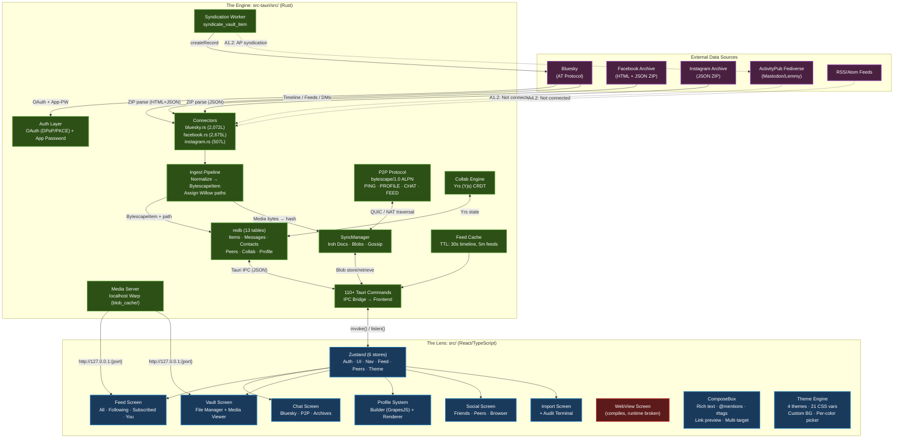
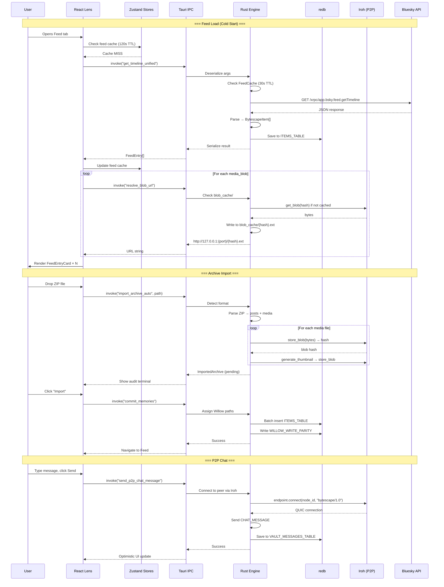

# Bytescape Technical Specification

**Last major revision:** 2026-03-25 — Server architecture (Phase 4.5) integrated. See §1.3, §4.2, §5, §7.

This document aggregates the core technical specifications for Bytescape: Architecture, System Design, Storage Boundaries, and Security.


---

# ARCHITECTURE


Bytescape is a local-first, peer-to-peer (P2P) social data vault and unified communication client.

**Core Philosophy:** "Low Floor, High Ceiling."
- **Low Floor:** Zero-configuration, cloud-like convenience for average users.
- **High Ceiling:** Fully independent, self-hosted and/or off-grid p2p capabilities for power users.

## 1. System Architecture: Engine & Lens

The system follows an unbundled design, separating heavy data processing from the user interface.

### 1.1 Bytescape Bridge (The Engine)
A headless backend service (`bytescape-bridge`) running locally on the user's device.
- **Role:** Manages the local database, P2P networking (`iroh`), cryptographic keys, and protocol bridges.
- **Capabilities:**
    - **Universal Ingestion:** Scrubs and normalizes data from Bluesky, ActivityPub, RSS, and legacy archives (Facebook/Twitter JSON).
    - **P2P Transport:** Encrypted communication via Iroh.
    - **Storage:** Manages the "Vault" (universal content store) using Willow-compatible data structures.

### 1.2 Bytescape (The Frontends)
Lightweight UI clients that plug into the Bridge.
- **Role:** Query the local database and render data through specific "Lenses".
- **Lenses:** Specialized views for different content types (e.g., a "Chat Lens" for DMs, a "Gallery Lens" for photos, a "Reader Lens" for articles), unified under a multifunctional application shell initially, with single function spinoff apps down the line.
- **Tech Stack:** Tauri v2 (Desktop/Mobile), React, TypeScript.

### 1.3 Bytescape Server (The Cloud Extension)
A unified server deployment at `bytescape.social` extending the local-first app into a hybrid platform. The server is always a blind relay for sovereign data — the desktop/mobile client remains the data authority.

- **Components:**
    - **AT Protocol PDS** (Tranquil PDS — Rust, Postgres): Hosts user repositories, serves XRPC, firehoses to Bluesky Relay. Native `did:web` support, passkeys, 2FA (TOTP/FIDO2), SSO.
    - **ActivityPub Instance** (custom `axum` server extending `src-tauri/src/activitypub/`): Federates with Mastodon/Lemmy/Threads, handles inbox/outbox/WebFinger.
    - **Iroh Relay**: Encrypted store-and-forward for edge clients, mobile push wakeup, P2P relay. No decryption — blind relay only.
    - **Sync Bridge**: Internal daemon translating between Iroh blobs ↔ SQL ↔ PDS repos ↔ AP objects.
    - **Identity Resolver**: Serves `/.well-known/did.json`, `/.well-known/webfinger`, `/.well-known/atproto-did`.
    - **Web Portal** (optional): Read-only public profiles via WASM Iroh client + React SPA.
    - **Caddy**: Reverse proxy with auto-TLS and wildcard `*.bytescape.social` subdomains.

- **Deployment:** Docker Compose stack (`caddy` + `postgres` + `pds` + `ap-server` + `iroh-relay` + `sync-bridge`). Self-hostable on any x86_64/arm64 with 2GB RAM. Initial deployment on developer hardware behind Cloudflare Tunnel.

- **Privacy Model:** No two-class privacy. Every user (web, desktop, mobile) gets client-side key generation and encrypted storage. Web users who opt into server-managed convenience get clearly disclosed trade-offs.

### 1.4 Client Adapter Pattern

The React frontend compiles into three targets from the same component tree:

| Provider | Target | Data Source | Auth |
|----------|--------|-------------|------|
| `TauriDataProvider` | Desktop + Mobile (Tauri) | Local Rust backend via `invoke()` | Keychain (local) |
| `RestDataProvider` | Web app (`bytescape.social`) | Server REST API via `fetch()` | JWT/OAuth (server) |
| `WasmProvider` | Visitor portal (read-only) | Iroh WASM node fetching public blobs | None (public only) |

All three share the same component tree, styles, and themes. Build-time flag selects the provider.

## 2. Data Architecture: The Willow Vault

All data is normalized into a hierarchical, path-based structure inspired by the [Willow Protocol](https://willowprotocol.org/). This enables file-manager-style browsing and P2P sync.

### 2.1 Willow Data Model

Data is organized in a 3-dimensional coordinate system:

| Dimension | Purpose | Bytescape Usage |
|-----------|---------|-----------------|
| **Namespace** | Top-level vault isolation | One per user vault |
| **Subspace** | Per-author data separation | User's own content vs imported sources |
| **Path** | Hierarchical addressing | `/{source}/{type}/{year}/{month}/{id}` |
| **Timestamp** | Version ordering | Original post timestamp (microseconds) |

**Path Schema:**
```
/{source}/{item_type}/{year}/{month}/{content_hash}

Examples:
/bluesky/status/2024/06/abc123...
/facebook/gallery/2023/12/vacation/def456...
/import/article/2022/03/ghi789...
```

**Rust crate:** `willow_25` from [earthstar-project/willow-rs](https://github.com/earthstar-project/willow-rs) provides ready-to-use types (Entry, Path, Area) with ed25519 signatures and BLAKE3 hashing.

### 2.2 The BytescapeItem Schema
The Vault stores three primary data types, each mapped to Willow entries:

1.  **Short Text (Status):** Microblogging posts (Bluesky, Mastodon).
2.  **Media Content (Gallery):** Visual posts (Instagram, Facebook Albums).
3.  **Link/Metadata (Article):** Long-form content (RSS, Substack).

Each item includes:
- `path`: Hierarchical location (`/{source}/{type}/{date}/{id}`)
- `subspace_id`: Author identity (user's key or source identifier)
- `timestamp`: Original creation time (microseconds)
- `payload_digest`: Content hash (for media: Iroh blob hash)
- `syndication_status`: `LocalOnly` | `PendingSyndication` | `Syndicated { at_uri }`

### 2.3 The Data Vault UI

The Vault is presented as a **file-manager interface**:
- **Browse by Source:** Folders for Facebook, Bluesky, Instagram, etc.
- **Browse by Type:** Filters for Status, Gallery, Article
- **Browse by Date:** Year → Month → Day hierarchy
- **Rich Media Preview:** Thumbnails, video playback, article rendering
- **Export:** Any item or folder can be exported as standard formats

### 2.4 Ingestion Pipeline
- **Live Bridge:** Real-time fetching from connected networks (Bluesky, ActivityPub).
- **Archive Importer:** Offline extraction for GDPR exports (Facebook JSON, etc.). 
  - Chunks media into Iroh blobs
  - Generates WebP thumbnails
  - Assigns Willow paths based on source and date
  - Default syndication: `LocalOnly`

### 2.5 Spatial Profile Discovery
Bytescape replaces algorithmic discovery with **spatial, graph-based exploration** — navigating the decentralized web the way hyperlinks worked on the old web.

- **Profile Graph Traversal:** Each user profile contains a manually curated list of links to other profiles, webrings, and communities. Users discover new people by following these links, not by algorithmic injection.
- **No Trending, No Explore:** The system has no discovery feed. Finding new people requires actively visiting profiles, subscribing to a hashtag, or following a webring link.
- **Webring Navigation:** Users publish a `com.platform.webring.member` Lexicon record to their local PDS pointing to a shared AT-URI. AppView indexers (see §7.3) stitch these independent records into a navigable loop or unified forum feed.
- **Network State Events:** The unified feed also surfaces **network state changes** — a contact updating their profile theme, joining a new webring, or publishing a new archive import — creating ambient awareness of the social graph without algorithmic injection.

## 3. Syndication & Audience Control

### 3.1 Syndication Model

Items have explicit syndication status to prevent accidental spam:
- **LocalOnly:** Stored in vault, never posted externally (default for imports)
- **PendingSyndication:** Queued for posting
- **Syndicated:** Posted to external network (stores AT URI or ActivityPub ID)

**Import Behavior:**
- Archives import as `LocalOnly` by default
- User can opt-in to "Post to Wall on Import" which queues items as `PendingSyndication`
- Syndication happens via background job, respecting rate limits
- Consider a "Memory" post type that signals "this is from my archive"

**⚠️ Bluesky Note:** Backdating `createdAt` doesn't prevent posts from appearing in followers' timelines *now*. True backfill without notification may require `com.atproto.repo.applyWrites` batch operations or explicit "Memory/Archive" post semantics.

### 3.2 Audience Circles

Posts can be scoped to specific audiences:
- **Public:** Syndicated to all connected networks
- **P2P Only:** Shared only with direct P2P contacts
- **Circles:** User-defined groups (e.g., "Close Friends", "Family", "Work")

### 3.3 Contextual Syndication (Smart Publisher)

Outbound posts are routed based on content type:
- **Short Text:** Broadcasts natively to Bluesky/Mastodon
- **High-Res Media:** Stored locally via P2P, "Keyhole" preview (low-res thumbnail + secure link) syndicated externally
- **Long-Form:** Posted as Article with preview card

## 3.4 Profile Generation (The Builder)

Every Bytescape user owns a **sovereign static profile** — a customizable mini-website served from their Willow store.

- **Visual Builder (GrapesJS):** A drag-and-drop module builder generates clean HTML/CSS for non-technical users. Widgets include away message, music player, friends list, and guestbook.
- **Raw Override:** Advanced users upload custom HTML/CSS/JS directly to their local Willow directory. Custom code runs in a sandboxed `<iframe>` to prevent XSS.
- **Dual-Format Serving:** The profile URL serves HTML to human visitors and structured data (Atom feed / AT Protocol Lexicons) simultaneously to feed aggregators. Backend consumers autodiscover the machine-readable endpoint via `<link rel="alternate">` in the HTML `<head>`.
- **DID Discovery via `<meta>` tags:** The profile embeds `<meta name="bytescape:did" content="did:plc:...">` so that the Bytescape client can resolve the owner's identity and populate cross-platform subscription links (ActivityPub, AT Protocol, RSS).
- **Aesthetic:** Profiles are visually inspired by MySpace/iGoogle — warmth, personality, tactile Aero-Skeuomorphic design language.

## 3.5 Peer Profile Browser

The Bytescape client acts as a **specialized browser** for traversing the P2P profile graph.

- **Browser Shell:** Manages identity resolution, Willow/Iroh sync, and the unified toolbar.
- **Sandbox `<iframe>`:** When visiting a peer's profile, the custom HTML/CSS/JS renders in an isolated frame to prevent malicious code affecting the host application.
- **`<meta>` Tag Extraction:** On each profile visit, the shell reads the embedded meta tags to surface the owner's DID, their followed hashtags, and available subscription endpoints.
- **Swarm Caching:** High-traffic profiles distribute load organically — visitors temporarily cache and re-serve the cryptographically signed profile data they view. Optional dedicated **Pub nodes** ensure 24/7 availability for users who want guaranteed uptime without self-hosting.
- **NAT Traversal:** Iroh handles direct QUIC connections with automatic NAT traversal and relay fallback.

## 4. Networking: "The People's Cloud"

Bytescape replaces centralized servers with a location-aware P2P mesh, supplemented by an always-on relay at `bytescape.social`.

### 4.1 Topology
- **Sovereign Nodes (Users):** The primary source of truth. Data lives on your device.
- **`bytescape.social` Relay (Phase 4.5):** Unified server providing:
    - **Iroh Relay:** Encrypted blob store-and-forward for offline devices. Mobile clients flush pending writes on app suspend; relay buffers incoming blobs and sends push notifications (APNs/FCM) to wake suspended apps.
    - **PDS Hosting:** AT Protocol Personal Data Server for Bluesky federation.
    - **AP Instance:** ActivityPub server for Mastodon/fediverse federation.
    - **Sync Bridge:** Bidirectional translation between Iroh, PDS, and AP.
- **Community Stations (Phase 5):** Encrypted "dumb stores" and Iroh relays.
    - **Role:** Provide 24/7 presence and bandwidth.
    - **Privacy:** Stations store *encrypted* shards; they cannot read user data.
    - **Auto-Docking:** Geohash-based discovery of nearest high-uptime Station.

### 4.2 Server Deployment
The entire server ships as a single `docker-compose.yaml`:
- `caddy` — Reverse proxy, auto-TLS, wildcard `*.bytescape.social` subdomains
- `postgres` — Shared database (Tranquil PDS + AP server + bridge)
- `pds` — AT Protocol PDS (Tranquil PDS — Rust, Postgres)
- `ap-server` — ActivityPub instance (custom axum)
- `iroh-relay` — Encrypted Iroh blob relay + push notifications
- `sync-bridge` — Internal daemon: Iroh ↔ SQL ↔ PDS ↔ AP translation

**Hardware:** Self-hosted testing (1-20 users): any machine with 2GB RAM, 50GB SSD. Small community (20-500): 4GB RAM, 2 CPU, 100GB SSD. Commercial scale (500+): 8GB+ RAM, 4+ CPU, S3 for blob offload.

### 4.2 Stealth Mode
Users can toggle "Stealth Mode" to sever all Station connections, relying purely on direct device-to-device Iroh connections or pairing with a self-hosted `bytescape-station` binary.

### 4.3 Resilience
- **Neighborhood Erasure Coding:** Data is sharded across the home station and regional neighbors. If a node fails, data can be rebuilt from parity shards.

## 5. Identity & Access

### 5.1 Identity Hierarchy (Phase 4.5)

Every Bytescape user has a layered identity:

| Level | Identifier | Purpose |
|-------|-----------|---------|
| **1. Umbrella** | `did:web:bytescape.social:{username}` | Universal root. DID Document links all protocol identities via `alsoKnownAs`. Set when username is chosen. Permanent. |
| **2. AT Protocol** | `did:plc:abc...` | Real PLC registered at `plc.directory`. PDS service endpoint → `pds.bytescape.social`. Only for Bluesky-connected users. |
| **3. ActivityPub** | `https://bytescape.social/@username` | Standard AP actor. Discovery via WebFinger `acct:username@bytescape.social`. No DID fabrication — AP does not use DIDs. |
| **4. P2P / Iroh** | `did:key:z6Mk...` | Self-certifying from Ed25519 keypair. Offline-capable. Used for P2P sync, device pairing, vault signing. |

`get_owner_did()` resolves via 3-level fallback: `did:web` → `did:plc` → `did:key`.

**Custom Domain Handles:** Users can bring their own domain (`alice.com`) as both an AT Protocol handle and a fediverse handle, making their personal website their identity root.

### 5.2 The "Two Doors" Flow
1.  **Door 1 (Verified Sovereign):**
    - Create a local DID.
    - "Blind Escrow" recovery: Encrypted key shard stored on a server, unlockable only with Master Password + 2FA.
2.  **Door 2 (OAuth Bridge):**
    - Log in with existing Bluesky/ActivityPub identity.
    - Instantly import social graph and establish sync.

### 5.2 Meadowcap Capabilities
Access control uses capability-based permissions (inspired by Willow's Meadowcap):
- Read/write permissions per namespace, subspace, or path prefix
- Delegatable capabilities for sharing specific folders

## 6. User Experience: The Library Model

Control shifts from the platform to the user.

### 6.1 Anti-Patterns (What We Don't Do)
- **No Algorithmic Discovery:** Content only appears if explicitly subscribed
- **No Infinite Scroll:** Feeds have a definitive end; UI signals completion
- **No "Starter Packs":** Onboarding avoids mass-following strangers
- **Strict Chronology:** Timelines sort by timestamp, not engagement

### 6.2 The Feed: Six Tabs
The timeline is segmented to protect high-signal relationships from high-volume topics:

1.  **All (The River):** Merged view of every source — live timeline, custom feeds, vault items — sorted strictly by timestamp. Friend posts are visually elevated above topic posts.
2.  **Following (The Inner Circle):** Strict chronological feed of posts from followed DIDs. No algorithms, no boosts, no injected content.
3.  **Feeds:** Subscribed Bluesky custom feed generators, selectable individually or merged.
4.  **#Hashtags (The Window):** Posts matching subscribed hashtags across all bridged networks. Each tag has a "Volume Knob" (Quiet/Normal/Loud) to throttle high-traffic tags.
5.  **RSS:** Atom/RSS feed subscriptions from blogs, newsletters, and podcasts. Stored and served from the Willow vault.
6.  **Archives:** Read-only view of locally imported content (Facebook, Instagram, etc.). Filterable by source.

### 6.3 Profile Customization

User profiles are **customizable** in the spirit of MySpace/iGoogle:
- **Widgets:** Away message, music player, friends list, guestbook, etc.
- **Custom Layouts:** Drag-and-drop widget arrangement
- **Custom Themes:** HTML/CSS (sandboxed in iframes for security)
- **Public Portal:** Static blurred preview; full content requires P2P decryption via WASM Iroh node

### 6.4 Aesthetic: Tactile Aero-Skeuomorphism
- **Frutiger Aero:** Reviving the warmth and depth of mid-2000s design
- **Skeuomorphism:** Digital textures (paper, glass) for intuitive affordance
- **Glass & Depth:** Translucent panels with background blur (Windows Aero style)

### 6.5 Theme Engine
- **Cozy Mode (Default):** Soft rounded corners, warm palettes, serif typography
- **Desktop Mode (Win98):** High-density data views, monospace fonts, sharp bevels
- **Custom Themes:** User-created via CSS-like syntax or visual editor

### 6.6 Haptics & Audio
- **Mechanical Profile:** Crisp clicks for definitive actions (Save, Publish)
- **Organic Profile:** Soft natural sounds (wood taps, paper) for passive scrolling
- **Silent Profile:** Pure haptic vibration patterns

## 7. Federation & Interoperability

### 7.1 Dual Protocol Stack

Bytescape federates via both AT Protocol and ActivityPub simultaneously from a single server:

**Client-Side (Tauri app):**
- **AT Protocol:** `atrium` / `bsky-sdk` for Bluesky identity and data operations via XRPC.
- **ActivityPub:** Direct `reqwest` HTTP client for Mastodon API interactions (timelines, posting, DMs). Note: `megalodon-rs` is a Mastodon REST API *client* library — useful as a unified SDK for talking to Mastodon-API-compatible servers, but distinct from the server-side AP implementation.

**Server-Side (`bytescape.social`):**
- **AT Protocol PDS:** Tranquil PDS (Rust, Postgres) — hosts user repositories, serves XRPC endpoints, firehoses to Bluesky Relay. Native `did:web` support, passkeys, 2FA (TOTP/FIDO2), SSO.
- **AP Instance:** Custom `axum` server extending `src-tauri/src/activitypub/` module — multi-user actor registry, persistent follower/following storage (Postgres), inbox/outbox, HTTP signatures, WebFinger, `Move` activity for account migration. GoToSocial is the documented fallback.
- **Sync Bridge:** Internal daemon bridging Iroh blobs ↔ SQL ↔ PDS repos ↔ AP objects. Maps `did:web` ↔ `did:plc` ↔ AP actor URLs.
- **Identity Resolver:** Serves `/.well-known/did.json`, `/.well-known/webfinger`, `/.well-known/atproto-did` from a single endpoint.

### 7.2 Protocol Adapters (Client-Side)
- **AT Protocol:** `bsky-sdk` / `atrium` for Bluesky identity and data
- **ActivityPub:** `reqwest` HTTP client for Mastodon API interactions
- **RSS/Atom:** `feed-rs` + `readability` for blogs and newsletters
- **Email (IMAP/SMTP):** `async-imap` + `lettre` + `mail-parser` for linked email accounts

### 7.3 WASM Web Portal
Public HTTP profiles serve static, blurred previews. Full-fidelity content requires loading a WebAssembly Iroh node in the browser to decrypt the P2P stream.

### 7.4 Webrings & Decentralized Forums
Groups and affiliations operate as cryptographic records rather than hosted spaces.

- **User-Initiated Membership:** A user publishes a `com.platform.webring.member` Lexicon record to their local PDS, pointing to a shared AT-URI that represents the webring or forum.
- **AppView Indexing:** Dedicated indexer components (part of `bytescape-bridge`, mirroring the primary AT Protocol parser architecture) monitor the AT Protocol firehose for these specific record types and stitch independent member nodes together into a navigable loop or unified forum feed.
- **No Central Host Required:** The webring exists as a set of distributed records. Any member can run an indexer to reconstruct the full loop from the firehose. If all indexers go offline, the records still exist on each member's PDS and can be re-indexed at any time.


## 8. Email Engine

Bytescape integrates email as a first-class communication channel, extending the multi-protocol vault to unify social posts, DMs, and email in one local-first interface.

### 8.1 Operating Modes

| Mode | Description | Server Dependency |
|------|-------------|-------------------|
| **A: Linked Email** | IMAP/SMTP client for existing accounts (Gmail, Outlook, etc.) | None |
| **B: AP Messaging** | Private AP messages via `@user@bytescape.social` addressing | AP host required |
| **C: Hosted Email** | Full `user@bytescape.social` email with MX infrastructure | MX server required |

Mode A ships first. Modes B and C build incrementally on Phase 4/5 infrastructure.

### 8.2 Architecture

```
┌──────────── FRONTEND (Lens) ─────────────┐   ┌──────────── BACKEND (Engine) ─────────────┐
│                                           │   │                                            │
│  EmailScreen.tsx (3-panel layout)         │   │  connectors/email.rs                       │
│    ├─ FolderSidebar                       │   │    ├─ ImapClient (async-imap)               │
│    ├─ ThreadList                          │   │    │   ├─ connect / authenticate             │
│    └─ MessageView (sandboxed HTML)        │   │    │   ├─ list_folders / fetch_headers       │
│                                           │   │    │   ├─ fetch_body (lazy, on demand)       │
│  EmailComposer.tsx (Tiptap-based)         │   │    │   ├─ IDLE (push) / poll (fallback)      │
│    ├─ To/CC/BCC with contact autocomplete │   │    │   └─ search (server-side IMAP SEARCH)   │
│    ├─ Subject + rich text body            │   │    │                                         │
│    └─ Attachment picker                   │   │    ├─ SmtpSender (lettre)                   │
│                                           │   │    │   ├─ send / reply / forward             │
│  hooks/useEmail.ts                        │   │    │   └─ multipart (HTML + plaintext)       │
│  store/emailStore.ts (Zustand)            │   │    │                                         │
│                                           │   │    ├─ EmailParser (mail-parser)              │
│                                           │   │    │   ├─ RFC 5322 / MIME parsing            │
│                                           │   │    │   ├─ JWZ thread reconstruction          │
│                                           │   │    │   └─ attachment extraction → Iroh blobs │
│                                           │   │    │                                         │
│                                           │   │    └─ VaultBridge                            │
│                                           │   │        └─ email → BytescapeItem (Article)    │
│                                           │   │                                              │
│                                           │   │  db/email.rs                                 │
│                                           │   │    ├─ EMAIL_HEADERS_TABLE (redb)             │
│                                           │   │    ├─ EMAIL_BODIES_TABLE (redb, lazy)        │
│                                           │   │    └─ EMAIL_ACCOUNTS_TABLE (redb)            │
│                                           │   │                                              │
└───────────────────────────────────────────┘   └──────────────────────────────────────────────┘
          │ Tauri IPC (invoke / events)                         │
          └─────────────────────────────────────────────────────┘
```

### 8.3 Data Model

**EmailAccount** — linked email account configuration:
- `id` (UUID), `owner_did`, `display_name`, `email_address`
- `imap_host`, `imap_port`, `smtp_host`, `smtp_port`
- `auth_method`: `Password` | `OAuth2` | `AppPassword`
- Credentials stored encrypted in keychain (NOT in the account record)
- `last_sync`, `active`

**EmailHeader** — envelope metadata (stored in redb for fast listing):
- `uid` (IMAP UID), `account_id`, `message_id` (RFC 2822)
- `in_reply_to`, `references[]` — for JWZ threading
- `from`, `to[]`, `cc[]`, `subject`, `date`, `folder`, `flags[]`
- `has_attachments`, `snippet` (first ~200 chars), `thread_id` (computed)

**EmailBody** — full message content (fetched lazily from IMAP on demand):
- `uid`, `account_id`, `text_plain`, `text_html`
- `attachments[]`: `{ filename, mime_type, size, blob_hash?, inline }`

### 8.4 Integration Points

The email engine reuses existing infrastructure extensively:

| System | Reuse |
|--------|-------|
| Identity (`LinkedAccount`) | Add `protocol: "email"` with IMAP/SMTP credentials |
| Message vault (`VaultMessage`) | Emails stored with `source: "email"` |
| Connector pattern (`Source` enum) | Add `Email` variant |
| Navigation (`Screen`/`SidebarItem`) | Add `"email"` as singleton module tab |
| Vault archival (`BytescapeItem`) | Emails archived as `Article` type |
| Blob storage (Iroh) | Attachments stored content-addressed |
| Contact graph | Email addresses merged with social contacts |
| Keychain (ChaCha20-Poly1305) | IMAP/SMTP credentials encrypted at rest |
| HTML sanitizer (DOMPurify) | Reused for email HTML rendering |
| Rich text editor (Tiptap) | Reused for email composition |
| OAuth2 flows | Reused for Gmail/Outlook authentication |

### 8.5 Security Considerations

- **HTML rendering**: Email HTML is adversarial. Rendered in sandboxed `<iframe srcdoc>` with DOMPurify sanitization. No `<script>`, `<iframe>` (nested), `onclick`, or remote resource loading by default.
- **Tracking pixel blocking**: Remote images blocked by default. User explicitly opts in per-message.
- **Credential storage**: IMAP/SMTP passwords and OAuth2 tokens stored in the existing encrypted keychain (ChaCha20-Poly1305 + Argon2id KDF). Never stored in plaintext.
- **OAuth2 token refresh**: Gmail/Outlook tokens require periodic refresh. Handled by the same token lifecycle management used for Bluesky and Mastodon OAuth.
- **Rate limiting**: Gmail IMAP has aggressive rate limits for OAuth2 apps. Exponential backoff on `THROTTLED` responses. Configurable sync intervals.

### 8.6 Crate Dependencies

| Crate | Purpose | Downloads | Status |
|-------|---------|-----------|--------|
| `async-imap` v0.11 | Async IMAP client (tokio-native) | 344K | Stable |
| `lettre` v0.11 | SMTP email sending | 7.7M | Very mature |
| `mail-parser` v0.11 | RFC 5322 / MIME parsing | 1.3M | Stalwart Labs |
| `mail-builder` | RFC 5322 message construction | ~500K | Stalwart Labs |

All crates use tokio async runtime (already in dependency tree). TLS via `tokio-rustls` (transitive through `reqwest`).

---

# SYSTEM DESIGN & DATA FLOWS


This document defines the end-to-end data flow and storage architecture for:

1. Bluesky/Facebook post cloning and timeline display
2. Media extraction and Vault storage/display
3. Messaging import + real-time chat + archived chat partitions
4. Hard deletion pathways (Clear Vault + account switch)
5. Email reading, composing, and vault archival

## 1) Data Sources

## Social post sources
- Bluesky API
  - Following timeline (`get_timeline`)
  - Saved custom feeds (`list_saved_feeds` + feed fetch)
- Facebook archive ZIP
  - Parsed posts + media references (`import_facebook_zip` → `commit_memories`)

## Messaging sources
- Bluesky DM API (live import/send)
  - `import_vault_messages`
  - `send_bsky_dm`
- Walled-garden archives (Facebook) — archived/read-only lane in UI model

## Email sources
- Linked IMAP accounts (Gmail, Outlook, ProtonMail Bridge, Fastmail, custom)
  - Headers synced incrementally (UIDVALIDITY + HIGHESTMODSEQ)
  - Bodies fetched lazily on demand
  - IDLE push notifications when app is focused
- ActivityPub direct messages (routed to email lens, Mode B)

## Media sources
- Remote media URLs discovered from Bluesky/Facebook connectors
- Local filesystem media extracted from archive ZIPs
- Blob-addressed media (`blob:<hash>`) in Iroh
- Email attachments (downloaded on demand, cached in Iroh blobs)

## 2) Display Interfaces

## Feed screen tabs
- Following: people/profile timeline only (Bluesky following timeline)
- Feeds: all followed custom feeds combined, with dropdown to select one feed or all
- All: merged + deduplicated union of Following + Feeds

## Vault screen
- File-first media browser from Iroh Docs metadata (`vault/file/*`)
- Fullscreen media viewer with navigation and optional metadata panel

## Chat screen
- Live lane: Bluesky/Mastodon sources (interactive composer)
- Archived lane: walled-garden sources (read-only)

## Email screen
- Folder sidebar: INBOX, Sent, Drafts, Spam, Trash, custom labels (per linked account)
- Thread list: sender, subject, snippet, date, unread/flagged indicators
- Message view: full email with threaded conversation history, sandboxed HTML rendering
- Composer: To/CC/BCC, subject, rich text body (Tiptap), attachments

## 3) Storage Configuration

## Local index store (redb)
- `ITEMS_TABLE`: normalized posts (`BytescapeItem`)
- `VAULT_MESSAGES_TABLE`: imported/sent messages (`VaultMessage`) with `owner_did`
- `CONTACTS_TABLE`, `CONVERSATIONS_TABLE`, `FOLLOWED_HASHTAGS_TABLE`, etc.

## Sync/media store (Iroh)
- Iroh Blobs: binary media bytes (content-addressed)
- Iroh Docs: Vault file catalog entries (`vault/file/{id}` -> `VaultFile`)

## Email store (redb)
- `EMAIL_HEADERS_TABLE`: envelope metadata (uid, message_id, threading refs, flags, snippet)
- `EMAIL_BODIES_TABLE`: full text/html bodies (fetched lazily from IMAP, cached locally)
- `EMAIL_ACCOUNTS_TABLE`: linked account config (credentials in encrypted keychain, not here)
- Attachments: downloaded on demand, stored in Iroh blob cache (content-addressed)

## Ownership and isolation
- Session owner DID is the tenant boundary.
- Messages are saved with `owner_did` and queried by owner.
- Logout clears local tables and synced vault file metadata.

## 4) End-to-End Flow

## A. Post cloning + feed rendering
1. Fetch from Bluesky timeline and saved feeds, parse Facebook archive posts.
2. Normalize to `BytescapeItem` and save to `ITEMS_TABLE`.
3. Feed UI composes views:
   - Following = timeline
   - Feeds = `get_unified_feed` over selected/all followed feeds
   - All = merge(Following, Feeds), sort by timestamp, dedupe by URI/CID

## B. Media extraction to Vault
1. Import connectors detect media paths/URLs.
2. Media bytes are stored in Iroh Blobs (or resolved from `blob:` hash).
3. A `VaultFile` metadata entry is written to Iroh Docs.
4. Vault UI lists from `vault_list_files` and streams bytes via `vault_get_file_data`.

## C. Messages and chat partitioning
1. Bluesky DM import stores messages as `VaultMessage { owner_did, source, ... }`.
2. Chat UI groups conversations by source:
   - live: `bluesky`, `mastodon`
   - archived: everything else
3. Send composer is enabled only for live conversations.

## E. Email reading, composing, and archival
1. User links an external email account (IMAP/SMTP credentials stored in encrypted keychain).
2. IMAP sync engine fetches headers incrementally → stored in `EMAIL_HEADERS_TABLE`.
3. Email screen renders thread list from cached headers (no body fetch yet).
4. User opens a thread → `email_fetch_body` fetches full MIME from IMAP → parsed via `mail-parser` → stored in `EMAIL_BODIES_TABLE`.
5. HTML body rendered in sandboxed iframe with DOMPurify sanitization. Remote images blocked by default.
6. Attachments listed but not downloaded until user clicks → saved to Iroh blob cache.
7. Compose/reply/forward → `lettre` sends via SMTP with proper `In-Reply-To` + `References` headers.
8. "Archive to Vault" action converts email → `BytescapeItem` (Article type) + attachments → Iroh blobs.
9. IMAP IDLE provides push notifications for new messages (emits `email-new-message` Tauri event).
10. Background sync polls every 60s when app is minimized (IMAP IDLE requires active TCP connection).

## D. Deletion pathways
- Clear Vault button:
  - clears all local user-scoped redb tables
  - clears all Iroh vault file metadata entries
- Logout/account switch:
  - clears all local user-scoped redb tables
  - clears all Iroh vault file metadata entries
  - clears pending import buffer
  - deletes session tokens

## 5) Required Functions / Contracts

## Import and feed contracts
- `import_bluesky_posts`
- `import_facebook_zip`, `commit_memories`
- `get_timeline`
- `list_saved_feeds`
- `get_unified_feed(tags, feed_uris, limit)`
- `list_follows(actor)`

## Vault/media contracts
- `vault_add_file`, `vault_upload_file`, `vault_upload_files_from_paths`
- `vault_list_files`, `vault_get_file_data`, `vault_get_thumbnail`
- `vault_delete_file`, `vault_deduplicate_files`, `vault_clear_all_files`

## Email contracts
- `email_add_account`, `email_remove_account`, `email_list_accounts`
- `email_list_folders(account_id)`
- `email_fetch_headers(account_id, folder, page, limit)`
- `email_fetch_body(account_id, uid)` — lazy fetch from IMAP
- `email_send(account_id, to, cc, bcc, subject, body, attachments)`
- `email_reply(account_id, in_reply_to_uid, body)`, `email_forward(...)`
- `email_search(account_id, query)` — server-side IMAP SEARCH
- `email_mark_read(account_id, uid)`, `email_mark_flagged(...)`
- `email_move_to_folder(account_id, uid, folder)`
- `email_delete(account_id, uid)`
- `email_sync_status(account_id)` — returns sync state + unread counts
- `email_archive_to_vault(account_id, uid)` — email → BytescapeItem + blobs

## Chat contracts
- `import_vault_messages`
- `send_bsky_dm`
- `list_vault_messages` (owner-scoped)

## Deletion/auth contracts
- `clear_vault` (full wipe of local + sync data)
- `logout` (full wipe + session removal)

## 6) Current Guarantees

- Cross-account leakage prevention for chats via `owner_did` scoping + full wipe on logout.
- Feed semantics match requested model (Following / Feeds with selector / All merged).
- Vault ingestion from imports writes media into vault catalog for discoverability.
- Deletion pathways remove both index records and synced vault media catalog entries.

This document defines the storage boundaries between **redb** (local database) and **Iroh** (P2P sync) to prevent data inconsistency and clarify ownership.

## Overview

Bytescape uses a **dual-storage architecture**:

| Storage | Purpose | Sync | Location |
|---------|---------|------|----------|
| **redb** | Local indexes, cache, user preferences | ❌ No sync | `$APPDATA/db.redb` |
| **Iroh Blobs** | Media files (images, videos) | ✅ P2P synced | `$APPDATA/sync/blobs/` |
| **Iroh Docs** | Vault file metadata, P2P documents | ✅ P2P synced | `$APPDATA/sync/docs.db` |

---

## Storage Decision Matrix

### What Goes Where

| Data Type | Storage | Rationale |
|-----------|---------|-----------|
| **User sessions** (JWT, DID) | redb (keychain file) | Local-only, security-sensitive |
| **Iroh node keys** | redb (keychain file) | Local-only, security-sensitive |
| **Bluesky posts** (imported) | redb `ITEMS_TABLE` | Local archive, fast queries |
| **Facebook posts** (imported) | redb `ITEMS_TABLE` | Local archive, fast queries |
| **P2P messages** | redb `MESSAGES_TABLE` | Local cache of received messages |
| **Contacts** | redb `CONTACTS_TABLE` | Local address book |
| **Conversations** | redb `CONVERSATIONS_TABLE` | Local conversation metadata |
| **Vault files** (metadata) | Iroh Docs `vault_namespace` | P2P synced file catalog |
| **Vault files** (content) | Iroh Blobs | P2P synced binary data |
| **Sync documents** | Iroh Docs | P2P CRDT state |
| **Followed hashtags** | redb `FOLLOWED_HASHTAGS_TABLE` | Local preferences |

---

## Data Flow Diagrams

### Import Flow (Bluesky/Facebook)

```
┌──────────────┐     ┌─────────────┐     ┌──────────────┐
│  External    │────▶│  Parser/    │────▶│  redb        │
│  API/ZIP     │     │  Connector  │     │  ITEMS_TABLE │
└──────────────┘     └─────────────┘     └──────────────┘
                            │
                            ▼
                     ┌─────────────┐
                     │  Iroh       │
                     │  Blobs      │
                     │  (media)    │
                     └─────────────┘
```

**Process:**
1. Connector fetches/parses external data
2. Media downloaded → stored in Iroh Blobs (returns hash)
3. Metadata + blob hashes → stored in redb `ITEMS_TABLE`
4. Item is queryable locally, media is P2P-synced

---

### Vault File Upload Flow

```
┌──────────────┐     ┌─────────────┐     ┌──────────────┐
│  User        │────▶│  Iroh       │────▶│  Iroh        │
│  File        │     │  Blobs      │     │  Docs        │
└──────────────┘     │  (content)  │     │  (metadata)  │
                     └─────────────┘     └──────────────┘
```

**Process:**
1. File bytes → stored in Iroh Blobs (returns hash)
2. Thumbnail generated → stored in Iroh Blobs (returns hash)
3. `VaultFile` metadata (name, size, hashes, tags) → stored in Iroh Docs
4. File is immediately P2P-synced to connected peers

---

### P2P Message Flow

```
┌──────────────┐     ┌─────────────┐     ┌──────────────┐
│  Remote      │────▶│  Iroh       │────▶│  redb        │
│  Peer        │     │  Connection │     │  MESSAGES_   │
│              │     │             │     │  TABLE       │
└──────────────┘     └─────────────┘     └──────────────┘
                            │
                            ▼
                     ┌─────────────┐
                     │  Frontend   │
                     │  Event      │
                     └─────────────┘
```

**Process:**
1. Incoming P2P connection accepted
2. Message received via bidirectional stream
3. Message persisted to redb `MESSAGES_TABLE`
4. Frontend notified via Tauri event
5. Message queryable from local DB

---

## Table Schemas

### redb Tables

```rust
// Local posts (Bluesky, Facebook imports)
ITEMS_TABLE: TableDefinition<&str, &str>  // Key: source:original_id, Value: JSON<BytescapeItem>

// P2P and Bluesky messages
MESSAGES_TABLE: TableDefinition<&str, &str>  // Key: message_id, Value: JSON<Message>

// Known contacts
CONTACTS_TABLE: TableDefinition<&str, &str>  // Key: did, Value: JSON<Contact>

// Conversation metadata
CONVERSATIONS_TABLE: TableDefinition<&str, &str>  // Key: conversation_id, Value: JSON<Conversation>

// User preferences
FOLLOWED_HASHTAGS_TABLE: TableDefinition<&str, &str>  // Key: tag, Value: timestamp
```

### Iroh Docs Entries

```
// Vault file metadata
vault/file/{file_id} → JSON<VaultFile>

// Sync documents (created per sharing session)
doc/{namespace_id} → CRDT state
```

### Iroh Blobs

```
// Media content addressed by hash
{hash} → bytes (image, video, etc.)
{hash}:thumb → bytes (WebP thumbnail)
```

---

## Ownership Rules

### Rule 1: redb is Local Cache
- redb data is **NOT** synced to peers
- redb can be rebuilt from Iroh + re-import if lost
- redb stores denormalized data for fast queries

### Rule 2: Iroh Docs is Source of Truth for Vault
- Vault file metadata lives in Iroh Docs
- Multiple peers can edit (CRDT resolution)
- redb may cache Iroh Docs data for performance

### Rule 3: Iroh Blobs is Content-Addressed Storage
- Content addressed by BLAKE3 hash
- Deduplicated automatically
- Thumbnails stored as separate blobs

### Rule 4: Security-Sensitive Data Stays Local
- JWT tokens → keychain file only
- Iroh secret keys → keychain file only
- Never sync credentials via P2P

---

## Migration Strategy

### Current State (Technical Debt)
- ❌ `BytescapeItem` stored in redb only (not P2P synced)
- ❌ `VaultFile` stored in Iroh Docs (separate from items)
- ❌ No clear migration path between systems

### Target State
1. **Unified Item Model**: All content items use Iroh Docs for P2P sync
2. **redb as Index**: redb stores materialized views for fast queries
3. **Sync on Import**: Imported items automatically synced to Iroh

### Migration Steps
1. Add `sync_id: Option<NamespaceId>` to `BytescapeItem`
2. On import, create Iroh Doc entry + store sync_id
3. Background job syncs existing redb items to Iroh
4. Queries check Iroh first, fallback to redb

---

## Performance Considerations

### Query Patterns

| Query | Storage | Notes |
|-------|---------|-------|
| List items by date | redb | Indexed, fast |
| List items by source | redb | Filter on source field |
| Get vault stats | redb | Pre-computed counts |
| Get file content | Iroh Blobs | Stream from blob store |
| Search content | redb | Future: full-text index |
| Sync status | Iroh Docs | Check CRDT state |

### Caching Strategy

```
┌─────────────────────────────────────┐
│  Frontend Request                   │
└──────────────┬──────────────────────┘
               ▼
┌─────────────────────────────────────┐
│  redb (fast path)                   │
│  - Items, Messages, Contacts        │
│  - Materialized views               │
└──────────────┬──────────────────────┘
               │ (cache miss)
               ▼
┌─────────────────────────────────────┐
│  Iroh Docs/Blobs (slow path)        │
│  - P2P fetch                        │
│  - Update redb cache                │
└─────────────────────────────────────┘
```

---

## Error Handling

| Error | Storage | Recovery |
|-------|---------|----------|
| redb corruption | redb | Delete + re-import from source |
| Iroh blob missing | Iroh Blobs | Fetch from P2P peers |
| Iroh doc conflict | Iroh Docs | CRDT auto-resolution |
| Keychain lost | File | User must re-login |

---

## Future Considerations

1. **Willow Protocol**: Consider migrating to Willow-compatible storage for true P2P interoperability
2. **Erasure Coding**: Add redundancy for blob storage across peers
3. **Selective Sync**: Allow users to choose which namespaces to sync
4. **Offline Mode**: Queue writes locally, sync when connected


---

# WILLOW MIGRATION STRATEGY


Date: 2026-02-22

## Scope
Evaluate replacing the current redb-backed `BytescapeItem` storage with a Willow-native store (`willow_store_simple_sled`), considering the current media-import pipeline and recently added Willow-style item paths.

## Current State

- Structured/social items (`BytescapeItem`, `VaultMessage`) are stored in `redb` via `DbManager`.
- Vault file metadata and blob references already live in Iroh Docs/Blobs (`SyncManager`), i.e. partially Willow-aligned behavior already exists for media.
- `BytescapeItem.path` has been added and backfilled using hierarchical format:
  - `/{source}/{type}/{year}/{month}/{id}`
- New imports now assign Willow-style paths at write time.

## Evaluation Summary

### Option A — Full Immediate Replacement (redb -> willow_store_simple_sled)

Pros:
- Single data model aligned with Willow from end to end.
- Path-native querying semantics.

Cons / Risks:
- Large blast radius: all read/write paths, dedupe keys, pagination, and filtering APIs must be rewritten.
- Potential feature regressions in import/feed/chat while replacing mature redb code.
- Current dependency ecosystem showed compile friction when enabling Willow crates in this codebase (resolved by feature-gating `willow_25`).

Assessment: **High risk right now**.

### Option B — Hybrid Staged Migration (recommended)

Pros:
- Keeps imports/feed/chat stable while continuing Willow conformance work.
- Uses `path` as migration contract now, enabling transparent backend swap later.
- Lets us migrate by domain (items first, then messages/contacts) with measurable checkpoints.

Cons:
- Temporary dual-store complexity.

Assessment: **Best balance of velocity + safety**.

## Decision

**Choose Option B (Hybrid Staged Migration).**

- Keep redb as active source of truth for structured item/message query paths in current release.
- Continue writing and maintaining canonical Willow paths on every `BytescapeItem`.
- Gate direct Willow crate usage behind Cargo feature flags until transitive dependency graph is stabilized.

## Proposed Execution Plan

1. **Stabilize path-indexed APIs on current store**
   - Add/expand path-prefix query interfaces on `DbManager` as migration-compatible API surface.
2. **Add shadow-write adapter (optional feature)**
   - On `save_item`, write to redb + Willow store in parallel under feature flag.
3. **Consistency verification tooling**
   - Compare counts/checksums/path coverage between stores.
4. **Read switch by endpoint**
   - Move archive/feed endpoints to Willow-backed reads once parity is proven.
5. **Remove redb item path for migrated entities**
   - Keep fallback read for one release cycle.

## Acceptance Criteria for Full Swap

- Import parity: Facebook, Instagram, Bluesky imports identical counts and media linkage.
- Feed parity: same item ordering and dedupe behavior across tabs.
- Migration safety: no data loss in backfilled paths and no missing records during restart.
- Performance: pagination and filtered reads remain within current UX latency.

## Notes on Dependencies

- `willow_25` has been integrated in feature-gated form (`feature = "willow"`).
- This allows immediate path-parameter conformance without destabilizing baseline builds.
- Full Willow storage activation should be coupled with dependency unification work before default enablement.


---

# SECURITY


This document outlines the security measures implemented in Bytescape to protect user data and credentials.

## 🔐 Encryption

### Keychain Encryption

All sensitive credentials are encrypted at rest using:

| Component | Algorithm | Purpose |
|-----------|-----------|---------|
| **Encryption** | AES-256-GCM | Authenticated encryption |
| **Key Derivation** | Argon2id | Memory-hard password hashing |
| **Salt** | 128-bit random | Unique per encryption |
| **Nonce** | 96-bit random | Unique per operation |

### Encrypted Data

The following data is encrypted in the keychain:
- Iroh node secret key (P2P identity)
- Bluesky DID (decentralized identifier)
- Bluesky handle
- Access JWT (short-lived API token)
- Refresh JWT (long-lived refresh token)

### Key Derivation Parameters

```rust
Argon2id (default parameters)
- Memory: 19 MB
- Iterations: 2
- Parallelism: 1
```

## 🛡️ Content Security Policy (CSP)

Bytescape enforces a strict CSP to prevent XSS and code injection attacks:

```
default-src 'self'           # Only load resources from app origin
script-src 'self'            # No inline scripts, no eval
style-src 'self' 'unsafe-inline'  # Inline styles needed for dynamic theming
img-src 'self' asset: https: data: blob:  # Allow app images and blobs
media-src 'self' asset: blob:  # Media from app and blob URLs
connect-src 'self' https: wss:  # API calls and WebSocket connections
font-src 'self'              # Only local fonts
frame-src 'none'             # No iframes
object-src 'none'            # No plugins
base-uri 'self'              # Prevent base tag hijacking
form-action 'self'           # Forms only submit to app
```

### CSP Restrictions

| Directive | Policy | Rationale |
|-----------|--------|-----------|
| `script-src` | `'self'` | Prevents XSS via injected scripts |
| `frame-src` | `'none'` | Prevents clickjacking |
| `object-src` | `'none'` | Prevents plugin-based attacks |
| `base-uri` | `'self'` | Prevents base tag hijacking |
| `form-action` | `'self'` | Prevents form data exfiltration |

## 🔑 Token Management

### JWT Token Lifecycle

| Token | Lifetime | Storage | Refresh |
|-------|----------|---------|---------|
| Access JWT | ~1 hour | Encrypted keychain | On expiration |
| Refresh JWT | ~90 days | Encrypted keychain | On use |

### Token Refresh Strategy

```rust
// Check if tokens need refresh (older than 1 hour)
if keychain.session_needs_refresh()? {
    let new_session = auth_manager.refresh_session(old_refresh_jwt).await?;
    keychain.save_session(new_session)?;
}
```

### Security Best Practices

1. **Never log tokens** - Tokens are never written to console or logs
2. **Secure deletion** - Session deletion overwrites with new encrypted data
3. **Memory protection** - Tokens cleared from memory when no longer needed

## 📁 File System Security

### Asset Protocol Scope

```json
{
  "assetProtocol": {
    "enable": true,
    "scope": ["$APPDATA/**", "**"]
  }
}
```

Files are only accessible within:
- `$APPDATA` - Application data directory
- Explicit user-selected paths (via file picker)

### Media Blob Cache

Media blobs fetched from Iroh are cached in:
```
$APPDATA/blob_cache/{hash}.{ext}
```

Access is restricted to:
- Application process only
- OS file permissions (user-only access)

## 🔒 P2P Security

### Iroh Node Security

- **Secret Key**: Generated once, stored encrypted in keychain
- **ALPN**: Custom protocol `bytescape/1.0` prevents cross-protocol attacks
- **Connection Encryption**: TLS 1.3 via QUIC
- **Peer Verification**: Public key-based identity

### Sync Document Capabilities

| Capability | Access Level | Use Case |
|------------|--------------|----------|
| `Write` | Full read/write | Document owner |
| `Read` | Read-only | Shared with peers |

## 🚨 Security Incident Response

### If Credentials Are Compromised

1. **Revoke Bluesky session**
   - Go to bsky.app/settings
   - Revoke all app passwords
   - Create new app password

2. **Rotate Iroh identity**
   - Delete `$APPDATA/keychain.json`
   - Restart Bytescape (generates new identity)

3. **Clear P2P connections**
   - Disconnect from all peers
   - Create new sync documents

### Reporting Security Issues

Report security vulnerabilities to:
- GitHub Security Advisories (private)
- Do not disclose publicly until patched

## 🔍 Security Audit Checklist

### Development
- [ ] No secrets in source code
- [ ] No secrets in logs
- [ ] CSP headers enabled
- [ ] Dependencies up to date

### Deployment
- [ ] Code signing enabled
- [ ] Secure update mechanism
- [ ] Minimal permissions

### Runtime
- [ ] Encrypted keychain in use
- [ ] Token refresh working
- [ ] P2P connections encrypted

## 📚 References

- [OWASP Secure Coding Practices](https://owasp.org/www-project-secure-coding-practices-quick-reference-guide/)
- [Tauri Security Guidelines](https://v2.tauri.app/concept/security/)
- [AES-GCM Specification](https://csrc.nist.gov/publications/detail/sp/800-38d/final)
- [Argon2 Specification](https://datatracker.ietf.org/doc/html/rfc9106)

---

# SYSTEMS ANALYSIS & STRATEGIC ROADMAP

*Prepared by the Systems Agent — 2026-03-15*
*Based on full codebase audit: ~22,925 lines Rust (46 files), ~12,000 lines TypeScript/React, 6,478 lines CSS, 110+ Tauri commands, 13 redb tables, 8 Source connectors, 13 screen types.*

> **Reading guide:** This analysis is structured as a gap-map between the **spec** (what TECHNICAL_SPEC.md and ROADMAP.md describe) and the **implementation** (what actually compiles and runs today). Each section grades the health of a subsystem on a 4-point scale: 🟢 Solid, 🟡 Functional with caveats, 🟠 Partially implemented, 🔴 Not yet started.

---

## 1. System Topology — Actual vs. Planned

The diagram below reflects the **actual, verified implementation state** as of this audit. Dashed lines indicate designed-but-unimplemented pathways.



### Key Observations from Topology

1. **Bluesky is the only live external protocol.** ActivityPub has scaffold code (7 modules, ~1,271 lines) but no live connection. RSS is not started.
2. **The Tauri IPC bridge is the single chokepoint.** All 110+ commands serialize as JSON strings over the Tauri IPC channel — there is no streaming, no binary protocol, no batching.
3. **P2P is operational but siloed.** Iroh handles blob storage, doc sync, and the custom `bytescape/1.0` protocol for peer chat/feeds, but the Iroh layer and the redb layer don't share transactional boundaries — orphan states are possible.
4. **The frontend has no router.** All navigation is Zustand-driven. `wouter` is installed as a dependency but never imported.

---

## 2. Subsystem Health Assessment

### 2.1 Authentication & Identity — 🟢 Solid

| Component | Lines | Status |
|-----------|-------|--------|
| OAuth (DPoP/PKCE/PAR) | 1,008 | Full AT Protocol OAuth. 5-port fallback. DPoP-bound tokens. |
| App-Password Auth | 74 | Simple but functional legacy path. |
| Dual-Auth Dispatch | ~150 in lib.rs | Transparent branching — every XRPC call auto-selects Bearer or DPoP. |
| Encrypted Keychain | 965 | ChaCha20-Poly1305 + Argon2id. Full identity lifecycle + escrow recovery. |
| Local-Only Identity | — | `did:key` from Iroh Ed25519 keypair. No external dependency. |

**Assessment:** This is the most mature subsystem. Both auth modes are production-grade, the keychain encryption is strong, and the identity recovery flow (escrow bundle + 3-step restore) is fully implemented. The DID hierarchy (`did:plc` > `master_did` > `local_did`) is well-reasoned.

**Risk:** The dual-auth branching in `lib.rs` duplicates ~150 lines of near-identical dispatch code. As more XRPC operations are added, this will become a maintenance hazard. Consider extracting a trait-based dispatch layer.

### 2.2 Data Ingestion Pipeline — 🟡 Functional with Caveats

| Connector | Lines | Format | Archive | Live Feed | Vault Media |
|-----------|-------|--------|---------|-----------|-------------|
| Bluesky | 2,072 | API | ✅ Import | ✅ Timeline + Feeds | ✅ Blob hash |
| Facebook | 2,675 | HTML + JSON | ✅ ZIP parse | ❌ No live API | ✅ Blob + FS |
| Instagram | 507 | JSON | ✅ ZIP parse | ❌ No live API | ✅ Blob |
| ActivityPub | 1,271 (scaffold) | — | ❌ | ❌ | ❌ |
| RSS/Atom | 0 | — | ❌ | ❌ | ❌ |
| Threads | 0 | — | ❌ | ❌ | ❌ |

**Strengths:**
- The universal `BytescapeItem` schema (42+ fields) is comprehensive — it handles status, gallery, article, video, and link types with full syndication tracking via `share_history` event sourcing.
- Facebook connector handles both HTML and JSON export formats with resilient path lookup (normalized, prefixed, basename fallback), double-UTF-8 decoding, and off-Facebook tracker detection.
- Willow-style paths (`/{source}/{type}/{year}/{month}/{id}`) are auto-assigned on every write — this is the migration contract for the future Willow store swap.

**Weaknesses:**
- **No streaming/chunked import.** Large archives are parsed entirely in-memory. A 2GB Facebook ZIP with thousands of photos will spike memory and potentially OOM. The `import_facebook_zip` function processes the entire ZIP synchronously before emitting results.
- **Classification is heuristic-based.** `BytescapeType` assignment (Video > Gallery > Article > Link > Status) relies on field counting and MIME sniffing rather than semantic analysis — edge cases (e.g., a single photo with 600 chars of text) may misclassify.
- **No incremental import.** There's no diffing against previously imported archives — reimporting the same ZIP duplicates items unless the key (`{source}:{original_id}`) happens to collide.

### 2.3 Storage Architecture — 🟡 Functional with Caveats

```
┌─────────────────────────────────────────────────────────────────┐
│                     STORAGE TOPOLOGY                            │
├─────────────────────────────────────────────────────────────────┤
│                                                                 │
│  ┌─────────────────────────┐    ┌─────────────────────────┐    │
│  │      redb (Local)       │    │     Iroh (P2P-Synced)   │    │
│  │                         │    │                         │    │
│  │  ITEMS_TABLE ◄──────────┼────┼── media_blobs[] hashes  │    │
│  │  MESSAGES_TABLE         │    │                         │    │
│  │  VAULT_MESSAGES_TABLE   │    │  Iroh Blobs             │    │
│  │  CONTACTS_TABLE         │    │  ├─ {hash} → media      │    │
│  │  CONVERSATIONS_TABLE    │    │  └─ {hash}:thumb → WebP │    │
│  │  PEERS_TABLE            │    │                         │    │
│  │  COLLAB_DOCS_TABLE      │    │  Iroh Docs              │    │
│  │  PROFILE_LAYOUT_TABLE   │    │  └─ vault/file/{id}     │    │
│  │  GUESTBOOK_TABLE        │    │     → VaultFile JSON    │    │
│  │  AP_ACTORS_TABLE        │    │                         │    │
│  │  FOLLOWED_HASHTAGS      │    └─────────────────────────┘    │
│  │  WILLOW_WRITE_PARITY    │                                    │
│  │  POSTS_TABLE (legacy)   │                                    │
│  └─────────────────────────┘                                    │
│                                                                 │
│  ⚠️  Cross-store reference: BytescapeItem.media_blobs[]         │
│     contains Iroh blob hashes — no foreign key constraint.      │
│     Orphan blobs possible if redb row deleted without           │
│     cleaning Iroh.                                              │
│                                                                 │
│  ⚠️  All redb tables are &str → &str (JSON serialized).        │
│     No type safety at storage layer. No secondary indexes.      │
│     Every non-key query is a full table scan + filter.          │
│                                                                 │
└─────────────────────────────────────────────────────────────────┘
```

**Critical concern: Scale ceiling.** The `&str → &str` table design means every query except direct key lookup requires deserializing all rows. With 10,000+ items (realistic for a user with multi-year social history + archives), feed loads will degrade. The `header_cache` (in-memory copy of all item metadata) mitigates this for feed pagination but is invalidated on every write — a write-heavy import flow will thrash the cache.

**The Willow Migration Strategy (Option B — Hybrid Staged)** is the correct call. The `WILLOW_WRITE_PARITY` table is already capturing audit data for every write, and path-indexed queries are available behind the `BYTESCAPE_WILLOW_PATH_ONLY_READS` feature flag. The bridge is being built while the road stays open.

### 2.4 P2P Networking — 🟢 Solid

| Component | Implementation | Status |
|-----------|---------------|--------|
| Iroh Endpoint | QUIC + NAT traversal + relay fallback | ✅ Cross-network verified |
| Protocol Router | 4 ALPNs: docs, gossip, blobs, `bytescape/1.0` | ✅ |
| Custom Protocol | PING, PROFILE_EXCHANGE, CHAT_MESSAGE, FEED_REQUEST | ✅ |
| Rate Limiting (CRIT-4) | 3 conn/peer, 60 req/min, 64KB payload, stale eviction | ✅ |
| Blob Storage | Content-addressed, WebP thumbnails, dedup by hash | ✅ |
| Docs (CRDT) | Create/join namespace, tombstone deletion, compaction | ✅ |
| Gossip | Presence broadcast | ✅ (basic) |

**This is Bytescape's moat.** The P2P stack is the hardest part of the system and it works — verified across networks via Pkarr DHT relay, cross-platform (desktop ↔ Android APK). The protocol design is clean: a simple request-type enum with rate limiting, bidirectional profile exchange, and feed serving (capped at 50 items per request to prevent abuse).

**Risks:**
- **Tombstone accumulation in Iroh Docs.** CRDTs can't truly delete — tombstones pile up. The `compact_vault_files` function replaces deleted entries with small marker blobs, but this is a band-aid. Long-lived vaults will accumulate dead weight.
- **No offline queue for P2P messages.** If a peer is unreachable, the message send fails immediately. There's no store-and-forward buffer — this is a Phase 5 (Community Stations) dependency.
- **Gossip is underutilized.** Only presence broadcasts use it. The architecture spec describes gossip for group discovery, collaborative editing awareness, and network state events — none of these are implemented yet.

### 2.5 Frontend Architecture — 🟡 Functional with Caveats

| Aspect | Assessment |
|--------|------------|
| Component structure | 🟡 Large monoliths — FeedEntryCard (684L), ChatScreen (644L), ProfileBuilderScreen (657L) |
| State management | 🟢 Fine-grained Zustand stores (6 independent stores) — minimal cross-store coupling |
| Navigation | 🟡 Store-driven, no URL router. `byte://` scheme exists internally but isn't wired to browser URLs |
| Tab system | 🟢 Browser-style tabs with preserved React state (`display: none` swap) |
| Data fetching | 🟢 Stale-while-revalidate via `useUnifiedFeed` + TTL feed cache. Stale request cancellation. |
| Styling | 🟠 6,478-line monolithic CSS file. No modules, no splitting. 4 full themes in one file. |
| Bundle | 🟡 GrapesJS (~500KB) is lazy-loaded. `wouter` installed but never used. `hls.js` may be partially dead. |
| Memoization | 🟠 `FeedEntryCard` not wrapped in `React.memo` — parent re-renders cascade to all cards |
| Testing | 🟡 12 test files covering key components, but major screens (ChatScreen, VaultScreen, FeedScreen) untested |

**Strengths:** The adapter pattern (`BlueskyPost` → `FeedEntry`, `BytescapeItem` → `FeedEntry`) cleanly isolates backend data shapes from rendering. The feed cache store with 120-second TTL enables true stale-while-revalidate. The theme engine is surprisingly deep — 21 customizable CSS variables, 7 background presets, file upload for custom backgrounds.

**Weaknesses:**
- **Memory growth from simultaneous tab rendering.** All 13 screen types render at once; inactive tabs are `display: none` but their React trees, effect cleanup, and interval timers remain alive. A user with 5+ peer profile tabs will hold 5 concurrent sets of blob-resolution state, feed data, and polling timers.
- **Blob resolution waterfall.** `useBlobUrl` makes individual IPC calls per blob hash. A feed page with 20 images fires 20 sequential Tauri invocations. Batch resolution would cut IPC overhead significantly.
- **The 6,478-line CSS file** is a ticking maintenance bomb. Every agent commit touches it. Four complete theme definitions means every style change must be replicated four times.

### 2.6 Syndication & Publishing — 🟡 Functional with Caveats

**Implemented:**
- `syndicate_vault_item` posts to Bluesky via `createRecord` with rich text facets, image uploads, and link card embeds.
- `share_history` event log with `active` flags enables rollback detection (`verify_syndications`).
- Import deduplication: timeline importers skip re-importing already-syndicated items.

**Not implemented:**
- No background syndication job — syndication is currently synchronous per-item.
- No rate limiting or backoff for bulk syndication.
- No AP syndication (depends on A1.2).
- `PendingSyndication` status exists in the schema but there's no queue processor consuming it.

### 2.7 Collaborative Editing — 🟠 Partially Implemented

The Yrs (Yjs Rust port) integration is functional for **local, single-user** editing:
- Documents stored as base64-encoded Yjs binary state in `COLLAB_DOCS_TABLE`.
- Frontend `useCollabDoc` hook manages Y.Doc lifecycle with debounced persistence.
- `ArticleEditor` supports Tiptap collaboration extensions.

**Missing the critical path:** Real-time P2P sync via Gossip (C6.3), offline merge (C6.4), and Station relay (C6.5) are all unimplemented. Without gossip-based update broadcasting, "collaborative editing" is actually "local Yjs document persistence." The architecture is sound — Yjs handles conflict resolution automatically — but the transport layer connecting two editors isn't built yet.

**Fragility note:** `collab.rs` uses `blocking_read()`/`blocking_write()` on the redb database. If called from an async Tauri command handler (which they are), these can block the Tokio runtime thread. Under load, this could cause deadlocks or response timeouts.

### 2.8 ActivityPub Federation — 🟠 Partially Implemented

Seven modules (~1,271 lines) provide the structural foundation:
- ActivityStreams JSON-LD types, Actor model, HTTP Signatures (RSA-SHA256)
- Inbox processing, Outbox delivery, WebFinger resolution
- `ApActor` stored in `AP_ACTORS_TABLE`

**What's missing:** No live connection to any Mastodon/Lemmy instance. No Follow/Accept flow. No DM routing. The AP code compiles and has types, but there's no `connect_activitypub()` or live feed ingestion. This is scaffolding waiting for the A1.2 milestone.

### 2.9 Browser & WebView — 🔴 Runtime Broken

`commands/browser.rs` has 4 Rust commands. `WebViewScreen.tsx` invokes them. Everything compiles, 250 tests pass. **URLs don't load at runtime** — likely because `get_window("main")` returns `None` due to a window label mismatch in `tauri.conf.json`. This has been investigated 5 times with 5 different approaches. Only the Rust `WebviewBuilder` approach is architecturally correct — it needs focused debugging, not another rewrite.

---

## 3. Architectural Strengths

### 3.1 The Unbundled Engine & Lens Pattern
The clean separation between the Rust Engine and React Lens is the project's most important structural decision. It means:
- **Future frontends are cheap.** A CLI vault tool, a mobile-only chat app, or a headless sync daemon could all consume the same 110+ Tauri commands without touching the Rust core.
- **The backend is frontend-agnostic.** Replacing React with Solid, Svelte, or a native Swift/Kotlin UI would require zero backend changes.
- **Testing is isolated.** Backend logic can be unit-tested in Rust without spinning up a WebView. Frontend components can be tested with mocked `invoke()` calls.

### 3.2 The BytescapeItem Universal Container
With 42+ fields covering identity, content, media, social metadata, syndication state, and Willow addressing, `BytescapeItem` is the gravity well that makes multi-network unification possible. The `share_history` event-sourcing pattern (rather than a single `syndication_status` field) is particularly well-designed — it enables:
- Knowing exactly *when* and *where* something was syndicated
- Rolling back syndications when upstream deletions are detected
- Supporting future multi-network syndication (post to Bluesky AND Mastodon simultaneously, track independently)

### 3.3 The Willow Migration Contract
Rather than attempting a big-bang storage rewrite, the team chose to:
1. Add Willow-compatible paths to every `BytescapeItem` now
2. Write parity audit data on every save
3. Gate the actual Willow store behind a Cargo feature flag
4. Provide canary read flags for gradual rollout

This is a textbook staged migration. The path-indexed APIs are already the migration surface — when the Willow store is ready, the read layer swaps transparently.

### 3.4 Dual-Auth Transparency
Supporting both OAuth (DPoP/PKCE/PAR) and app-password auth simultaneously, with transparent dispatch at the XRPC call layer, means users can authenticate however they prefer without the rest of the system caring. The `is_oauth_session()` branching is inelegant but functional — it can be refactored into a trait-based dispatch layer without touching any caller.

### 3.5 P2P-First with Federation Bridge
Most projects start centralized and try to bolt on P2P later. Bytescape starts P2P-first (Iroh mesh, content-addressed blobs, `did:key` identity) and bridges *outward* to centralized networks. This means the sovereignty model is structural, not aspirational — even if every external API went down, two Bytescape users could still sync data over QUIC.

---

## 4. Weaknesses, Technical Debt & Risk Vectors

### 4.1 🔴 Critical: No Secondary Indexes on redb

**Impact:** Every non-key query is a full table scan.

All 13 redb tables use `TableDefinition<&str, &str>` — string key to JSON string value. Queries like "all items from Facebook sorted by date" require:
1. Open a read transaction
2. Iterate every row in `ITEMS_TABLE`
3. Deserialize each JSON string to `BytescapeItem`
4. Filter by `source == Facebook`
5. Sort by `original_timestamp`

At 1,000 items this is fast. At 50,000 items (a realistic long-term vault with multi-year social history + archives), this becomes multi-second. The `header_cache` mitigates feed pagination but is invalidated on every write.

**Recommended path forward:** Either:
- Add secondary index tables in redb (e.g., `ITEMS_BY_SOURCE_TABLE`, `ITEMS_BY_DATE_TABLE` with composite keys)
- Move to SQLite/DuckDB for the local index layer while keeping redb for simple KV (keychain, preferences)
- Accelerate the Willow store migration, which would provide path-native querying

### 4.2 🟠 High: Cross-Store Consistency Gap

`BytescapeItem.media_blobs[]` contains Iroh blob hashes, but there's no foreign-key constraint or transactional guarantee between redb and Iroh. Failure modes:

| Scenario | Result |
|----------|--------|
| redb row deleted, Iroh blob survives | **Orphan blob** — wasted storage, no cleanup path |
| Iroh blob lost (peer sync failure), redb row survives | **Broken reference** — image shows as missing in feed |
| App crash mid-import (redb written, Iroh blob not yet stored) | **Dangling hash** — item references media that doesn't exist |

The Willow migration (unifying items + media under one store) is the long-term fix. In the interim, a consistency-check background job (compare redb blob references against Iroh blob inventory) would catch drift.

### 4.3 🟠 High: Monolithic CSS

6,478 lines in a single `App.css`. Four complete theme definitions. Every component style. Every responsive breakpoint. This is the #1 contributor to agent merge conflicts and style regressions.

**Recommended path forward:**
- CSS Modules (`.module.css` per component) for component-scoped styles
- Theme variables in a dedicated `themes/` directory (one file per theme)
- Keep a thin `global.css` for resets, custom properties, and scrollbar styles

### 4.4 🟡 Medium: IPC Serialization Overhead

Every Tauri `invoke()` call serializes arguments to JSON, passes them over the IPC bridge, deserializes in Rust, processes, serializes the result back to JSON, and deserializes in TypeScript. For a feed load with 50 items (each with 42+ fields, media arrays, facets), this is a non-trivial serialization tax.

Compounding factors:
- `useBlobUrl` fires individual IPC calls per blob hash (no batching)
- P2P keepalive polls `check_peer_connectivity` for each peer sequentially
- `useUnifiedFeed` may trigger multiple feed fetches (timeline + vault) and merge them in TypeScript

### 4.5 🟡 Medium: Frontend Component Monoliths

Three components exceed 600 lines each:
- `FeedEntryCard` (684 lines) — handles media grids, video, link previews, quote posts, engagement bar, audience pills, syndication, threads, reactions
- `ProfileBuilderScreen` (657 lines) — GrapesJS integration, custom blocks, preview mode
- `ChatScreen` (644 lines) — three-column layout, tabbed conversations, polling

These are hard to test, hard to review, and prone to cascading re-renders. `FeedEntryCard` especially should be decomposed: `MediaGrid`, `EngagementBar`, `SyndicationDrawer`, `ThreadReplies` could each be their own components.

### 4.6 🟡 Medium: 27 Cargo Warnings

Unused imports, dead code, unused variables across the Rust codebase. Not errors, but they obscure real issues during development. A `cargo clippy` pass with `#![deny(warnings)]` would clean this up.

### 4.7 🟡 Medium: Dead Dependencies

| Dependency | Status |
|-----------|--------|
| `wouter` (npm) | Installed, never imported. Remove it. |
| `hls.js` (npm) | Installed, but HLS resolution happens in Rust (`resolve_hls_video`). May be partially dead. Audit usage. |
| `willow_25` (Cargo, feature-gated) | Correctly gated. Not default. No action needed. |

---

## 5. Data Flow Analysis — Critical Paths

### 5.1 Feed Rendering Path (Latency-Critical)

```
User opens Feed tab
    → useUnifiedFeed checks feed cache store (120s TTL)
        → Cache HIT: render immediately, background refresh
        → Cache MISS:
            → invoke("get_timeline_unified") — Rust
                → Check FeedCache (30s TTL timeline, 5m saved feeds)
                    → API Cache HIT: return cached
                    → API Cache MISS:
                        → SHARED_CLIENT.get(bsky API) — HTTP
                        → Parse response → BytescapeItem[]
                        → Save to redb ITEMS_TABLE
                        → Return to frontend
            → TypeScript: adapt to FeedEntry[]
            → For each media_blob: invoke("resolve_blob_url") — individual IPC!
            → Render FeedEntryCard × N
```

**Bottleneck analysis:**
1. **Cold start:** No cache → API fetch → redb write → IPC return → blob resolution × N. Estimated: 2-5 seconds.
2. **Warm start:** Feed cache hit → immediate render. Estimated: <100ms.
3. **Tab switch:** Tab preserved in DOM (`display: none` swap). Estimated: instant.
4. **Blob resolution:** N sequential IPC calls for N images. This is the primary warm-path bottleneck.

**Recommendation:** Add a batch blob resolution command (`resolve_blob_urls(hashes: Vec<String>)`) to cut N IPC calls to 1.

### 5.2 Archive Import Path (Throughput-Critical)

```
User drops ZIP onto ImportScreen
    → Tauri drag-drop event → filesystem path
    → invoke("import_archive_auto") — Rust
        → Detect format (FB HTML / FB JSON / IG JSON)
        → Open ZIP in memory
        → Parse all posts → Vec<BytescapeItem>
        → For each media file:
            → Extract from ZIP
            → Store in Iroh Blobs → hash
            → Generate WebP thumbnail → store → hash
        → Emit progress events → frontend terminal
    → Result stored in AppState.pending_import
    → User clicks "Import"
    → invoke("commit_memories") — Rust
        → For each BytescapeItem:
            → Assign Willow path
            → Save to redb ITEMS_TABLE
            → Write parity audit to WILLOW_WRITE_PARITY
        → For each VaultMessage:
            → Save to VAULT_MESSAGES_TABLE
```

**Bottleneck analysis:**
1. **Memory:** Entire ZIP is processed before any results are returned. A 5GB archive with 10,000 photos will hold all parsed data in memory simultaneously.
2. **Thumbnail generation:** Each WebP thumbnail is generated synchronously. Image decoding + resizing + encoding is CPU-intensive.
3. **No resume/checkpoint:** If the app crashes mid-import, everything must be re-processed.

**Recommendation:** Implement chunked streaming import — process N items at a time, commit each chunk, emit progress. Use `tokio::task::spawn_blocking` for CPU-intensive thumbnail generation to avoid starving the async runtime.

### 5.3 P2P Message Path (Latency-Sensitive)

```
Peer A sends message
    → invoke("send_p2p_chat_message")
        → Iroh endpoint.connect(peer_B_node_id, "bytescape/1.0")
            → NAT traversal / relay fallback
        → Send CHAT_MESSAGE over bidirectional stream
        → Save to local VAULT_MESSAGES_TABLE
        → Return success

Peer B receives message
    → BytescapeProtocol::accept() triggered
    → Rate limit check (3 conn/peer, 60 req/min)
    → Parse CHAT_MESSAGE
    → Save to VAULT_MESSAGES_TABLE
    → Emit "p2p-message" Tauri event → frontend
    → ChatScreen event listener updates UI
```

**This path is clean.** The only concern is the lack of store-and-forward — if Peer B is offline, the send fails immediately with no retry queue. This is acceptable for now; Community Stations (Phase 5) will add relay buffering.

---

## 6. Strategic Opportunities — Ranked by Impact × Feasibility

### Tier 1: High Impact, High Feasibility (Do Now)

| Opportunity | Impact | Effort | Rationale |
|-------------|--------|--------|-----------|
| **Batch blob resolution IPC** | Feed render speed ×5 | 1 session | Single biggest UX improvement per engineering hour |
| **CSS modularization** | Dev velocity, fewer regressions | 2-3 sessions | Eliminates #1 source of merge conflicts |
| **Window maximized on launch** | First impression | 5 minutes | One line in `tauri.conf.json` |
| **Wire export button** | Feature completion | 30 minutes | Backend exists, frontend button exists, just connect them |
| **Cargo warning cleanup** | Code health | 1 session | `cargo clippy --fix` + review |
| **Remove dead deps** | Bundle size, clarity | 15 minutes | `pnpm remove wouter`, audit `hls.js` |

### Tier 2: High Impact, Medium Feasibility (Next Sprint Cycle)

| Opportunity | Impact | Effort | Rationale |
|-------------|--------|--------|-----------|
| **Secondary indexes or SQLite migration** | Scale to 50K+ items | 3-5 sessions | Eliminates the performance ceiling on feed/vault queries |
| **Chunked archive import** | Handle large archives without OOM | 2-3 sessions | Critical for users with decade-long social histories |
| **AP live connection (A1.2)** | Doubles the federated network | 5-8 sessions | Unlocks Mastodon/Lemmy/Threads — the biggest user-facing expansion |
| **RSS/Atom connector** | New content type pipeline | 2-3 sessions | `feed-rs` crate is well-maintained; straightforward integration |
| **WebView debugging (B10.7)** | In-app browsing | 1-2 sessions | Root cause is likely window label mismatch — focused debugging, not rewrite |
| **Background syndication queue** | Reliable multi-network posting | 2-3 sessions | `PendingSyndication` exists in schema but has no consumer |

### Tier 3: High Impact, Long Horizon (Strategic Investment)

| Opportunity | Impact | Effort | Rationale |
|-------------|--------|--------|-----------|
| **AI-Enhanced Local Vault Search** | Killer feature — semantic search over private data | Research + 5-10 sessions | On-device LLM (ONNX/candle) for "find the photo of X." Zero-knowledge — data never leaves device. |
| **Community Station Protocol** | "The People's Cloud" — resilient P2P mesh | 10-15 sessions | Encrypted store-and-forward relay enables offline messaging, profile availability, and Yjs collab relay. |
| **Pluggable Lens Extension API** | Third-party ecosystem | 8-12 sessions | WASM/iframe sandbox for custom views (Kanban, Calendar, Analytics). Turns Bytescape into a platform. |
| **Willow Store Full Migration** | Architecture unification | 10+ sessions | Replace redb with Willow-native store for items + messages. Enables true P2P content sync. |
| **Geospatial Features (B4-B7)** | Hyperlocal social — unique market position | 15-20 sessions | Map-based discovery, local groups, marketplace. Requires `leaflet`/`maplibre-gl` + geohash indexing. |

### Tier 4: Moonshots (Research Phase)

| Opportunity | Notes |
|-------------|-------|
| **Content Provenance (C2PA)** | Prove photos are real, not AI-generated. Depends on C2PA Rust SDK maturity. |
| **Device Attestation** | Android Play Integrity / Apple DeviceCheck for bot resistance. Privacy implications need evaluation. |
| **DNS-over-HTTPS for WebView** | System-level DNS override for anti-tracking. Platform-dependent feasibility. |
| **WASM Web Portal** | Public profiles via WebAssembly Iroh node in browser. Iroh WASM support is experimental. |

---

## 7. Dependency Risk Assessment

### External Service Dependencies

| Dependency | Risk | Mitigation |
|-----------|------|------------|
| Bluesky API (`bsky.social`) | Rate limits, API changes, downtime | Local-first design means app works without it; cached content survives disconnection |
| Bluesky OAuth (`bsky.social/.well-known/`) | Discovery endpoint changes | `CloudflareDnsTxtResolver` custom DNS for `_atproto-did.` records; PDS URL resolved from JWT |
| Iroh relay servers | Relay downtime blocks NAT-traversal | Direct QUIC connection works without relay if both peers have public IPs; Pkarr DHT fallback |
| Cloudflare DoH (`1.1.1.1`) | DNS resolution for OAuth handle lookup | Fallback to system DNS should be added |

### Crate/Library Dependency Risks

| Dependency | Version | Risk | Notes |
|-----------|---------|------|-------|
| `iroh` | 0.35.0 | Pre-1.0 API churn | Pin version, track releases |
| `atrium-oauth` | 0.1 | Very early — API may change significantly | Currently works; monitor `atrium` releases |
| `yrs` | 0.21 | Stable but niche | Yjs compatibility verified; CRDT semantics well-tested |
| `redb` | 2.4 | Stable | Consider migration to SQLite for secondary indexes |
| `grapesjs` (npm) | 0.22 | Large bundle (~500KB), complex API | Lazy-loaded; consider lighter alternative if bundle grows |
| `react` | 19.1 | Bleeding edge (React 19) | Concurrent features not yet leveraged; potential for Suspense boundaries |

---

## 8. Cross-Cutting Concerns

### 8.1 Error Handling Architecture

The Rust backend has a structured `BytescapeError` hierarchy:

```
BytescapeError
├── Auth(String)
├── Database(String)
├── Network(String)
├── Sync(String)
├── Import(String)
├── Io(std::io::Error)
├── SerdeJson(serde_json::Error)
├── Redb(redb::Error)
└── Other(String)
```

However, most Tauri commands return `Result<T, String>` — the structured error types are `.to_string()`'d before crossing the IPC bridge. The frontend catches all errors in generic `try/catch` blocks with toast-style display. There's no error categorization on the frontend (e.g., "retry-able network error" vs. "permanent auth failure").

### 8.2 Observability & Debugging

**Current state:** Minimal. No structured logging, no telemetry, no performance metrics.
- Rust uses `println!` / `eprintln!` for debug output
- No `tracing` crate integration (despite it being a standard Rust observability tool)
- Frontend has no performance monitoring (no `React.Profiler`, no `PerformanceObserver`)
- No way to inspect P2P connection state from the UI beyond "connected" / "disconnected"

**Recommended:** Add `tracing` with `tracing-subscriber` for structured, filterable logging. Emit span data for critical paths (feed fetch, archive import, P2P connection). This will be invaluable for debugging performance issues and P2P connectivity problems.

### 8.3 Testing Coverage Map

```
                    ┌──────────────────────────────┐
                    │        TEST COVERAGE          │
                    ├──────────────────────────────┤
                    │                              │
                    │  RUST BACKEND                │
                    │  ├── blob_hash.rs    ██████  │  17 tests
                    │  ├── oauth.rs        █████   │  30 tests
                    │  ├── error.rs        ███     │  
                    │  ├── classify.rs     ██      │  
                    │  ├── facebook.rs     ██      │  
                    │  ├── db.rs           █       │  
                    │  ├── iroh_sync.rs    █       │  
                    │  ├── keychain.rs     █       │  
                    │  └── (rest)          ░░░░░░  │  No tests
                    │                              │
                    │  FRONTEND                    │
                    │  ├── richtext.test   ████    │  Facet parsing
                    │  ├── useCharCount    ███     │  28 tests
                    │  ├── ThemeCustom.    ███     │  20 tests
                    │  ├── ThemePicker     ██      │  5 tests
                    │  ├── ComposeBox      ██      │  
                    │  ├── ArticleEditor   ██      │  
                    │  ├── useCollabDoc    ██      │  18 tests
                    │  ├── useLocation     █████   │  45 tests
                    │  ├── SourceBadge     █       │  
                    │  ├── RichText        █       │  
                    │  ├── ProfileBuilder  █       │  
                    │  ├── sanitize        █       │  
                    │  └── SCREENS         ░░░░░░  │  No tests
                    │                              │
                    └──────────────────────────────┘
```

**Gap:** No screen-level integration tests. `FeedScreen`, `ChatScreen`, `VaultScreen`, and `LoginScreen` — the four most important user-facing surfaces — have zero test coverage. The backend connectors (2,072L Bluesky, 2,675L Facebook) have minimal test coverage relative to their complexity.

---

## 9. Maturity Model — Where Bytescape Sits Today

| Dimension | Level | Evidence |
|-----------|-------|----------|
| **Core Data Model** | ██████████ 90% | `BytescapeItem` is comprehensive. Willow paths assigned. Share history event-sourced. |
| **Bluesky Integration** | ████████░░ 80% | Full OAuth, timeline, feeds, DMs, posting, syndication. Minor gaps (likes on feed items sometimes stale). |
| **Archive Import** | ███████░░░ 70% | FB + IG parsers work. Quality filtering improved. No chunked/streaming import. No incremental re-import. |
| **P2P Networking** | ████████░░ 80% | Iroh fully operational. Custom protocol with rate limiting. Cross-network verified. No store-and-forward. |
| **Identity & Auth** | █████████░ 90% | Dual-auth, encrypted keychain, DID hierarchy, escrow recovery. Production-grade. |
| **Feed UX** | ██████░░░░ 60% | 4-tab system works. Content filters functional. Performance cached but not profiled. |
| **Chat** | ██████░░░░ 60% | Bluesky DMs + P2P chat work. Archives imported. No offline queue. No read receipts. |
| **Vault/Files** | ███████░░░ 70% | Full file manager. Upload, preview, delete, dedup. No search. No tagging UI. |
| **Profile Builder** | █████░░░░░ 50% | GrapesJS integrated with custom widgets. Runtime broke once, fixed. No peer-to-peer serving. |
| **ActivityPub** | ██░░░░░░░░ 20% | Scaffold code. Types, signatures, inbox/outbox. No live connection. |
| **Collaborative Editing** | ███░░░░░░░ 30% | Yjs storage + Tiptap integration. No P2P sync. No awareness protocol. |
| **Browser/WebView** | █░░░░░░░░░ 10% | Compiles. Runtime broken. Window label mismatch. |
| **Geospatial** | ░░░░░░░░░░ 0% | Not started. |
| **Community Stations** | ░░░░░░░░░░ 0% | Not started. |

---

## 10. Systems Interaction Diagram — Current Implementation



---

## 11. Recommended Execution Priorities

Based on this analysis, here is the recommended priority ordering for the next development cycles:

### Immediate (This Week)
1. Add `"maximized": true` to `tauri.conf.json` window config
2. Wire the export button in SettingsScreen to `export_vault_data`
3. Remove `wouter` from package.json
4. Run `cargo clippy --fix` to clean 27 warnings

### Short-Term (Next 2 Sprints)
1. **Batch blob resolution** — new Tauri command `resolve_blob_urls_batch(hashes: Vec<String>)` returning `HashMap<String, String>`
2. **CSS modularization** — split `App.css` into per-theme and per-component files
3. **`React.memo` on FeedEntryCard** — prevent cascading re-renders in feed
4. **WebView window label fix** — check `tauri.conf.json` window labels against `get_window("main")` call

### Medium-Term (Next Quarter)
1. **RSS/Atom connector** — `feed-rs` crate, background polling, `BytescapeType::Article`
2. **ActivityPub live connection** — build on existing scaffold, target Mastodon read-only first
3. **Background syndication queue** — consume `PendingSyndication` with rate limiting + exponential backoff
4. **Secondary indexes or SQLite** — break the 10K-item performance ceiling
5. **Structured logging** — `tracing` crate with filterable spans for critical paths
6. **Email Engine (Mode A)** — linked IMAP/SMTP accounts via `async-imap` + `lettre` + `mail-parser`. ~3–4 weeks with 2 agents parallel. See §8 and Phase 6 in ROADMAP.

### Long-Term (Next 6 Months)
1. **Community Station Protocol** — encrypted store-and-forward relay
2. **Email Engine (Mode B/C)** — AP-address messaging + hosted `@bytescape.social` email (depends on Phase 5 hosting)
3. **AI local search** — on-device embedding model for semantic vault queries
4. **Lens Extension API** — WASM/iframe plugin system for third-party views
5. **Geospatial features** — map view, local groups, marketplace

---

*End of Systems Analysis. This document should be updated after each major sprint to reflect implementation progress and recalibrated priorities.*

