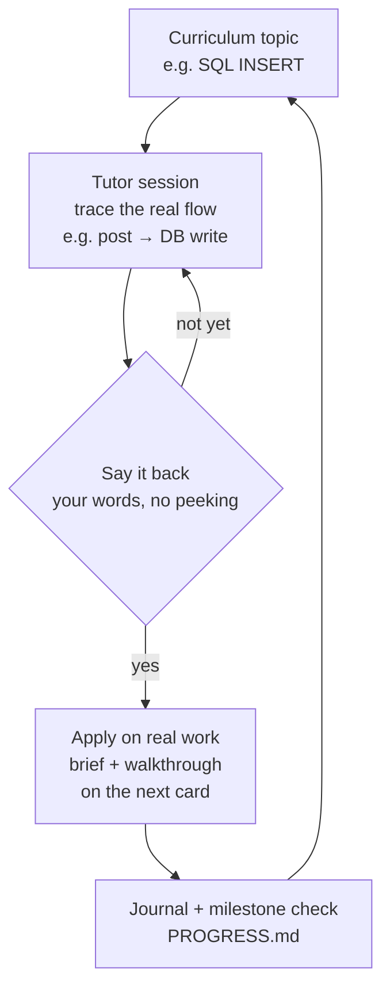

# Learning Framework — how to use the Bytescape Onboarding curriculum

The companion *Bytescape Onboarding* curriculum (7 phases, 00–07), kept alongside this repository, is the textbook.
This document is the missing framework: how the curriculum, tutor sessions, and real
development work fit together so you build personal understanding instead of just
shipping agent output.

Owner: the human. Agents read this to support learning; they do not own it.

## The core rule: units, not calendar

The curriculum assumes 4–6 h/day over 26 weeks. Ignore the calendar. Keep the phase
order, treat each week-of-curriculum as a **unit** (≈ 4–6 h of your time), and gate
progress on mastery, not dates:

> A unit is passed when you can explain its core concept in your own words and
> recognize it in Bytescape source code.

Run at whatever pace is sustainable alongside running the product. 1–2 units/week is
excellent. Stall-and-revisit is normal. Speed is not the goal; unaided explanation is.

## The three layers

| Layer | What | When | Artifact |
|---|---|---|---|
| 1. Curriculum | Reading + exercises from the phase files | Your own study time | Journal entry in `PROGRESS.md` |
| 2. Tutor sessions | Flow-tracing on the **real** Bytescape code (`.omp/agents/tutor.md`) | 1–2× per week, 30–60 min | Session doc in `docs/learning/` |
| 3. Explain-first dev work | Every real change gets a change brief + diff walkthrough (see AGENTS.md) | Every sprint task | Brief + walkthrough you understood |

Layer 1 gives vocabulary. Layer 2 anchors it in reality. Layer 3 is the practicum.
The failure mode this replaces: finishing a phase of study with no idea how it maps to
your own product — or shipping 38 sprints of code you never understood.

## The unit loop

## Phase → repo map

The curriculum is generic (it teaches you to build toy projects). This is where each
phase lands in Bytescape — tutor sessions should trace these areas:

| Phase | Curriculum file | Bytescape code | Tutor sessions |
|---|---|---|---|
| 1. Foundations (wk 1–2) | `01-phase-01-foundations.md` | tooling, git history, `wiki/getting-started/` | Repo tour: what runs where |
| 2. Rust core (wk 3–6) | `02-phase-02-rust-core.md` | `bytescape-server/src/{api,error.rs,db}` | Trace one API handler; the error path |
| 3. Databases & servers (wk 7–10) | `03-phase-03-databases-servers.md` | `bytescape-server/src/db`, migrations, `src/api` | **Session 01: trace a post from UI to DB** |
| 4. Frontend (wk 11–14) | `04-phase-04-frontend-react.md` | `apps/web/src/{screens,components,utils}` | Feed render; one screen's state |
| 5. Federation & crypto (wk 15–19) | `05-phase-05-federation-advanced.md` | `bytescape-server/src/{bluesky,pds,appview,auth}` | Login/auth round trip; ATProto sync |
| 6. Project immersion (wk 20–23) | `06-phase-06-project-immersion.md` | cross-cutting features (import, chat, events) | One feature end-to-end, both repos |
| 7. Autonomous contribution (wk 24–26) | `07-phase-07-autonomous-contrib.md` | the whole tree | You lead; agent assists |

## Assessments

Keep the curriculum's milestones (they are good). Add one gate per unit: the
**say-it-back** — 3 takeaways in your own words, checked by the tutor, no reading.
Log both in `PROGRESS.md`. If a say-it-back fails twice, re-trace a smaller flow
before moving on.

## Session mechanics

- `/tutor` — the next session per this plan. `/tutor <topic>` — that flow or concept.
  Plain text works the same ("tutor new", "teach me X"). Teaching only, no code
  changes. The commands appear in autocomplete after an OMP restart (or `/reload-plugins`).
- `/explain` — a plain-language explanation of the current change; `/explain <thing>` —
  of any file, flow, or concept. This is the say-it-back gate on demand.
- Prefer *flows* ("how does following a user work?") over topics ("teach me SQL")
  once Phase 2 is underway. Topics come from the curriculum; flows make them stick.
- Keep sessions 30–60 min. One flow per session. End with the recap the tutor enforces.
- JetBrains RustRover is your map (find-usages, debugger), not the teacher. Open it
  during tutor sessions to *see* the code the tutor anchors.

## Getting started (do these, in order)

1. Run `/tutor` — the first session is "repo tour: what runs where": layers, the two codebases, the live server.
2. Start Phase 1 (`01-phase-01-foundations.md`) at your own pace; journal it.
3. Read `docs/learning/session-01-tracing-a-post.md` — the first guided flow, pre-written.
4. On your next real task, read the change brief before any code is written (automatic now); use `/explain` whenever you want more depth.
