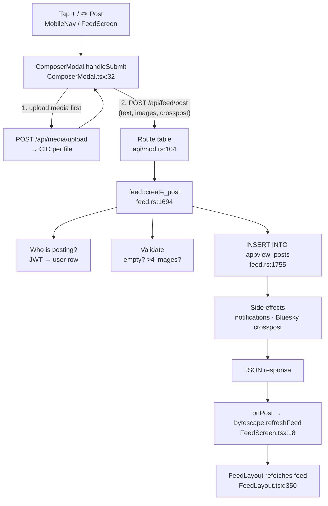

# Session 01 — Tracing a post from tap to database

**Level:** Phase 1–3 bridge · **Time:** 30–45 min · **Prereqs:** none

How to use this doc: open the anchored files in RustRover/your IDE as you read. Stop at
every **Checkpoint** and answer before continuing — out loud or in your journal. For the
live, interactive version, run `/tutor trace a post` and it will walk this with
you. Every anchor below was verified against source on 2026-09-25.

## The map



## The story, before any code

You type a post and tap the button. The browser doesn't know what a "post" is — it just
sends a small message (an HTTP request) to your server. The server looks at the message
and decides: is this allowed? who sent it? is it valid? Then it writes a row into the
database, maybe pings Bluesky and mentioned users, and sends a message back saying
"done, here's the post." The browser hears "done" and re-downloads the feed so the new
post appears. That's the whole loop. Everything below is just the details.

## The walk

### 1. The tap opens the composer

Tapping `+` (MobileNav) or `✏️ Post` doesn't call the server at all. It broadcasts a
browser event, and FeedScreen listens for it:

```ts
// apps/web/src/screens/FeedScreen.tsx:13
window.addEventListener('bytescape:openComposer', handler);
```

**Concept — event:** a named signal ("something happened") that any part of the page can
listen for, without knowing who sent it. Decouples the button from the composer.

### 2. Submit gathers the message and the key

`handleSubmit` (ComposerModal.tsx:32) is the function that runs when you tap Post. Two
things it needs: the content, and your identity key — a login token stored in the
browser after you signed in:

```ts
// apps/web/src/components/ComposerModal.tsx:38
const token = localStorage.getItem('bytescape_token');
```

### 3. Media goes first, as separate requests

If you attached images, each one is uploaded **before** the post is created — one HTTP
request per file:

```ts
// apps/web/src/components/ComposerModal.tsx:45
const res = await fetch(`${API}/api/media/upload`, { method: 'POST', ... });
```

Each upload comes back with a **CID** — a content identifier, essentially the file's
fingerprint. The post itself then only carries fingerprints, not files.

**Concept — CID (content identifier):** an ID derived from the content itself. Send the
fingerprints and the server can find the files. (AT Protocol's world is built on these.)

### 4. The actual post request

```ts
// apps/web/src/components/ComposerModal.tsx:60-71
const res = await fetch(`${API}/api/feed/post`, {
  method: 'POST',
  headers: { 'Content-Type': 'application/json', Authorization: `Bearer ${token}` },
  body: JSON.stringify({ text: content.trim(), images: imageCids, crosspost: ... }),
});
```

Read it as a sentence: "POST (please create) `/api/feed/post` (a post), on behalf of
`Bearer <token>` (this signed-in user), containing this JSON body."

**Concept — HTTP request parts:** method (POST = create), path (which endpoint), headers
(metadata, incl. auth), body (the payload). The response mirrors it: status code + body.

> **Checkpoint A** — before reading on: the server receives this request. What are the
> first three things it should check before saying yes?

### 5. The route table: URL → function

The server keeps a giant routing table mapping URLs to Rust functions:

```rust
// bytescape-server/src/api/mod.rs:104
.route("/api/feed/post", axum::routing::post(feed::create_post))
```

**Concept — route / handler:** a *route* is one URL+method entry in the table; the
*handler* is the function that runs when a matching request arrives. Here the handler is
`create_post` in `bytescape-server/src/api/feed.rs`. (axum is the Rust web framework;
you'll see `State<AppState>` = shared access to the database pool.)

### 6. The handler validates first

`create_post` (feed.rs:1694) starts with guard rails:

```rust
// bytescape-server/src/api/feed.rs:1708-1718
if post_is_empty(has_text, has_media, has_link, has_quote) {
    return Err(AppError::BadRequest("Post is empty — add some text, media, or a link".into()));
}
if req.images.len() > 4 {
    return Err(AppError::BadRequest("A post can contain at most 4 media attachments".into()));
}
```

**Concept — validation:** never trust incoming data. The same rules exist client-side
(ComposerModal.tsx:33 guards empty submits), but client-side checks are for convenience —
the server's checks are the real ones. Both, always.

### 7. Identity: who is posting?

The handler reads the `Bearer` token, turns it into your user ID, and loads your user row
(did, username, avatar) from the `users` table (feed.rs:1727-1747,
`viewer_id_from_headers` in api/profile.rs, `UserRow::find_by_id` in db/users.rs).

**Concept — JWT:** the token is a *signed* card the server handed you at login. It can
verify it without a lookup: it literally encodes "user X, valid until Y" plus a signature
nobody can forge.

> **Weird thing #1 — spotted live:** if the token is missing or invalid, this handler
> doesn't reject the request. It falls back to a placeholder author
> (`did:web:placeholder.bytescape.social`, handle `placeholder`) and creates the post
> anyway — a "legacy pre-auth" behavior (feed.rs:1727-1747).
>
> **Checkpoint B** — why is that risky? What could a stranger do to your database right
> now? (This is a real finding from this trace — jot it down; it deserves its own fix
> session later.)

### 8. The post gets an address

A post needs a unique, forever-stable address in AT Protocol style:

```rust
// bytescape-server/src/api/feed.rs:1720-1725 — the rkey is a timestamp
let rkey = format!("{}{}", now.timestamp_millis(), (now.timestamp_subsec_nanos() % 1000) as u16);
// feed.rs:1749 — the full address
let uri = format!("at://{}/app.bsky.feed.post/{}", author_did, rkey);
```

Example: `at://did:plc:abc123/app.bsky.feed.post/1758812345678123`.

**Concepts — DID / rkey / record URI:** a *DID* is a permanent account ID (like a social
security number for an identity, but self-owned). An *rkey* is the per-record key. The
URI is the post's home address: `at://<who>/<what type>/<which one>`. This addressing
scheme is what makes federation possible later — any AT Protocol app can find this post.

### 9. The write: one row into the database

```rust
// bytescape-server/src/api/feed.rs:1755-1768
sqlx::query(
    "INSERT INTO appview_posts (uri, cid, author_did, author_handle, text, created_at, embeds, indexed_at)
     VALUES ($1, $2, $3, $4, $5, $6, $7, NOW())
     ON CONFLICT (uri) DO NOTHING",
)
.bind(&uri).bind(&cid)...
```

**Concepts — SQL INSERT / table:** a *table* is a spreadsheet the database keeps; each
post is one row. `INSERT` adds a row. `ON CONFLICT (uri) DO NOTHING` = if a row with this
address already exists, silently skip — a cheap idempotency guard ("running twice can't
create duplicates").

> **Weird thing #2:** the `cid` written here is generated from the rkey
> (`format!("bafy{}", &rkey[..12])`, feed.rs:1750) — it *looks* like a content hash but
> isn't one; it's a synthetic placeholder. Real CIDs (like the ones from step 3) are
> computed from content. Fine for the local app-view; wrong the moment an outside AT
> Protocol server tries to verify content. Also worth its own session.

### 10. Side effects: the "and also..." work

After the insert, the handler does optional extras: mention notifications
(`insert_notification`, db/notifications.rs) and, if you ticked Bluesky, a crosspost to
your linked Bluesky account via an XRPC call
(`RemotePdsClient::create_record`, pds/atproto_client.rs) — that one crosses the
federation boundary to a server that is *not yours*.

**Concept — side effect:** anything a request does beyond computing its answer (writing
rows, sending notifications, calling other servers). They're where bugs hide, because
they multiply the ways a request can half-succeed.

### 11. The reply

The handler returns `CreatePostResponse` — the created post as JSON with a success
status. If anything above failed, you instead get an error status (like 400) with a
message — exactly what ComposerModal.tsx:77-82 shows in the UI.

### 12. The UI refreshes — by re-downloading everything

```ts
// apps/web/src/screens/FeedScreen.tsx:18-19
const handleNewPost = () => {
  window.dispatchEvent(new CustomEvent('bytescape:refreshFeed'));
};
```

FeedLayout listens for `bytescape:refreshFeed` and re-runs `loadFeed()`
(FeedLayout.tsx:338-358) — the *whole feed* is fetched again, rather than just appending
your post.

> **Weird thing #3, and it's a good design question:** refetching everything is simple
> and always consistent, but wasteful. Appending locally is fast but can drift from the
> server's truth (ordering, filters, enrichment). Products switch to smart local updates
> only when scale demands it. Simple + correct is a perfectly good tradeoff at your stage.

> **Checkpoint C** — close the doc and tell the whole story back in your own words:
> tap → … → post on screen. Then do it again naming the files.

## Vocabulary (all from this session)

| Term | Plain meaning | Where it lives here |
|---|---|---|
| Event | Named signal any code can listen for | `bytescape:refreshFeed` (FeedScreen.tsx) |
| HTTP request | Message with method, path, headers, body | `fetch(...)` calls (ComposerModal.tsx) |
| Route / handler | URL entry → function that answers it | api/mod.rs:104 → feed.rs:1694 |
| JWT / Bearer token | Signed "who I am" card from login | `Authorization` header (ComposerModal.tsx:61) |
| Validation | Server-side refusal of bad input | feed.rs:1708-1718 |
| CID | Fingerprint of content | media upload response (step 3) |
| DID / rkey / `at://` URI | Permanent identity + record address | feed.rs:1720-1749 |
| SQL INSERT | Add a row to a table | feed.rs:1755 (`appview_posts`) |
| Side effect | Extra work beyond the answer | notifications, Bluesky crosspost |

## Recap

1. A "post" is one HTTP request routed to one Rust function that writes one database row
   — the rest is guard rails and side effects.
2. The server never trusts the browser: it re-validates and re-derives identity from a
   signed token.
3. The frontend stays dumb: create → hear "done" → refetch. Simple, correct, wasteful —
   a deliberate tradeoff at this stage.

**Vocabulary to own:** handler, JWT, idempotency (`ON CONFLICT ... DO NOTHING`).
**Question you should now be able to answer:** *What happens, in order, between tapping
Post and seeing it in your feed — and which step is the only one that changes stored
data?* (Answer it now, before the next session.)

## Next session (suggested)

`trace: how a login becomes an identity` — JWTs end-to-end (auth round trip), which will
also give you the vocabulary to discuss weird thing #1 properly. Alternative:
`trace: how the feed is assembled` (the read path this session's step 12 kicks off).
