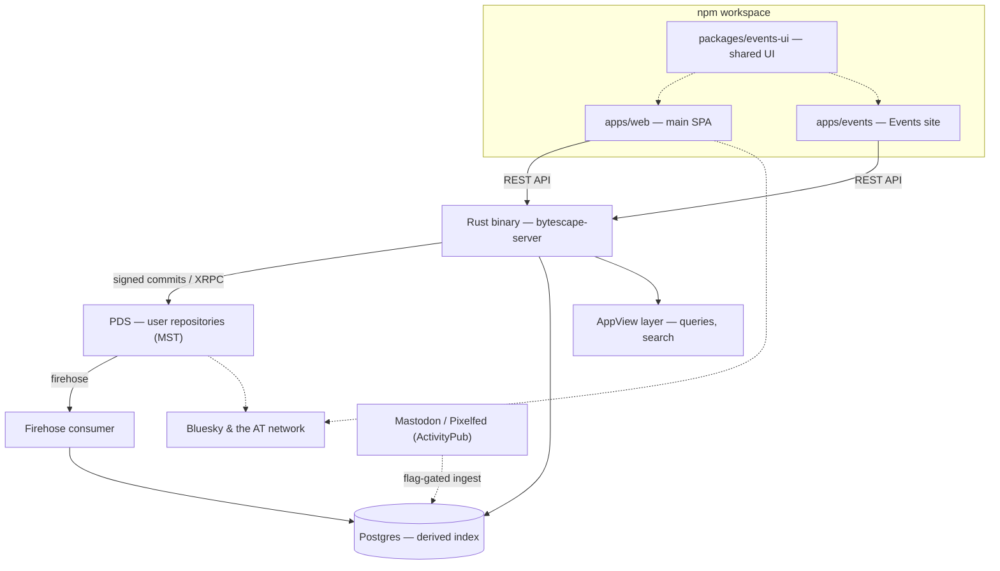

# Architecture

How Bytescape is built and why. This page is the current public overview; the
full decision record with implementation detail lives in
[`decisions.md`](decisions.md).

## System overview

Bytescape is an **AT Protocol** application with **ActivityPub** integration
rolling out — a dual-protocol platform, both protocols native in one
codebase (the Wafrn model; see [`ap-pivot-plan.md`](ap-pivot-plan.md)).
Natively-authored content — posts, follows, likes, events — is written to the
user's own PDS repository first, and the app's database is a *derived index*
for those records. ActivityPub content (Mastodon notes, Pixelfed stories) lands
in the same index through flag-gated ingest arms.

**One Rust binary serves three roles:** the PDS (writes, signed repos), the
AppView (firehose-derived indexes and query APIs), and the REST API for the
frontends. The frontends are React + Vite apps in an npm workspace — the main
app and the standalone Events site mount the same shared UI package, so
sections ship as independent deployables without forking code. In production,
Caddy terminates TLS and serves the OAuth client metadata as static content —
deliberately independent of app uptime.

## Components at a glance

| Component | Where | Role |
|---|---|---|
| PDS layer | `bytescape-server/src/pds/` | User repositories: signed MST commits, record CRUD, `did:web` identities |
| Firehose consumer | `bytescape-server/src/appview/` | Ingests the network firehose (AT) into the derived index; AP ingest arms feed the same tables |
| REST API | `bytescape-server/src/api/` | Auth (Bluesky + fediverse OAuth), import, profiles, feed, events, chat, community surfaces |
| Data access | `bytescape-server/src/db/` + `migrations/` | Postgres schema (migrations are the source of truth) and queries |
| Main SPA | `apps/web/` | Feed, profile + widget grid, import, stories, chat, vault |
| Events site | `apps/events/` | Standalone Events deployable → `events.*.bytescape.social` |
| Shared section UI | `packages/events-ui/` | One Events component tree mounted by both hosts |
| Deployment | `deploy/` | Server bootstrap (Caddy, systemd, OAuth metadata) + wiki publish tooling |

## Two protocols, one account

- **AT Protocol ships today.** Sign in with Bluesky; content lives in AT
  repositories; topic feeds are real AT Protocol feeds anyone can follow.
- **ActivityPub is the active build** (decided 2026-11-02, `Wafrn` as the
  reference model): every account becomes an AT + AP actor cross-linked via
  `alsoKnownAs`, sign-in expands to Bluesky / Mastodon / email, and Mastodon +
  Pixelfed content flows into the same feed and stories index. Both phases are
  feature-flagged (`AP_ACTORS_ENABLED`, `AP_INGEST_ENABLED`) and additive —
  if AP ever regresses the shipped app, the flag comes off and nothing else
  changes. Details: [`ap-pivot-plan.md`](ap-pivot-plan.md); stories wire
  mapping: [`stories-cross-protocol.md`](stories-cross-protocol.md).

## Data model, in one paragraph

Protocol-native content — posts, follows, likes, and events/RSVPs
(`community.lexicon.calendar.*`) — is written to the user's PDS as AT Protocol
records and federates like any other AT Proto content; after each of our own
writes the index is updated directly (fast path) and reconciled by the
firehose consumer. Presentation state (widget layouts, themes, profile
customization) lives in the app database by design. Imported archives and the
community extras (forums, exchange, wall) **currently live as app-database
rows** — storing them as custom `com.bytescape.*` records is the documented
direction (AD-01), not yet the behavior. Schema map:
[`database.md`](database.md).

## Architecture decisions (summary)

Full detail and rationale: [`decisions.md`](decisions.md).

| ID | Decision | Why / status, in one line |
|---|---|---|
| AD-00 | ~~AT Protocol only — no ActivityPub~~ | **Superseded 2026-11-02** — dual-protocol pivot; AP is additive alongside AT |
| AD-01 | PDS-first writes; Postgres is a derived index | Data portability is the product; the database can be rebuilt from the firehose |
| AD-01b | Two hosting paths: Bytescape-hosted (`did:web`) and Bluesky-hosted (`did:plc`) | Users bring an existing identity or start here — same code path either way |
| AD-01c | Reuse existing community lexicons where they exist | Interoperate instead of inventing private formats — events (`community.lexicon.calendar`) are live |
| AD-01d | Chat: Bluesky DMs first, Roomy-style groups second | Best-in-class 1:1 without new protocol surface; group spaces follow the portability axis |
| AD-02 | Single binary, clear module boundaries | One deployable for a small team; boundaries enforced by module layout |
| AD-03 | `did:web` identities for Bytescape-hosted users (for now) | Operationally simple; Bluesky-linked accounts use `did:plc` (AD-01b) |
| AD-04 | Error handling conventions (typed API errors, no silent failures) | Predictable client behavior and debuggable operations |
| AD-05 | Testing strategy: verification by exercised evidence | Builds green is necessary, not sufficient — changed behavior is demonstrated |
| AD-06 | Dependency choices (vendored `rsky` crates for repo/MST) | Battle-tested AT Proto internals without maintaining a full PDS implementation |

Product-level decisions — monetization, moderation posture, platform
priority — live in `VISION.md` and `DECISIONS.md`, not here.

## Related documents

- `VISION.md` — what we're building and why (product truth)
- `STATUS.md` — current phase and next actions (living truth)
- [`../product/mvp-scope.md`](../product/mvp-scope.md) — what ships next, and the shelf gates
- [`database.md`](database.md) — schema map
- [`../developers/getting-started.md`](../developers/getting-started.md) — run it locally
- `docs/README.md` — the project map (tools, process, how to run)
